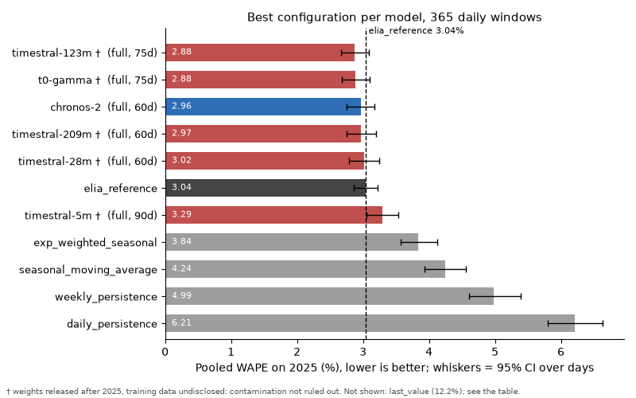

# TSFM Belgian Load Benchmark

This benchmark compares zero-shot time series foundation models (Chronos-2,
four sizes of Timestral, and t0-gamma) with simple baselines and Elia's own
day-ahead forecast on Belgian electricity load, using Elia's public
15-minute data.

Over all 365 days of 2025, the best foundation models with calendar and
temperature covariates land on par with Elia's forecast: Chronos-2 scores
2.96% WAPE against Elia's 3.04%, a gap that sits inside the confidence
intervals. The lowest scores, about 2.88% from Timestral 123M and t0-gamma,
come with a caveat: both models' weights were released after the test year,
so training-data contamination is not ruled out. The next step is a rerun
on Elia data from after 15 October 2026.



Models: Chronos-2, Mistral Timestral 5M/28M/123M/209M and t0-gamma, versus baselines and Elia's day-ahead forecast.
CPU only, `uv`, Python 3.12. Adding a model = one adapter file + one model card + its id in the `tsfm-all` group.
Full experiment summaries (context sweeps, slices, paired tests, figures) are tracked in [results/](results/);
`bench summarize` writes them there. Regenerate the chart with `uv run python scripts/plot_leaderboard.py` after
`bench summarize`.

## Results
<!-- results:start -->
_Auto-filled by `bench summarize` (2026-11-13 15:49 UTC). Best configuration per model on 2025 (365 daily windows), pooled over all scored points; Δ is paired over the same days (negative = better than elia_reference). Context and covariates were selected on 2025 itself, so the best-per-model WAPE is optimistic; see the full context sweep in [the experiment summary](results/leaderboard/summary.md)._

| model                   | covariates   | ctx (days)   |   WAPE ↓ % | CI95 %         |   median-window WAPE ↓ % | Δ vs elia_reference (pp) [CI95]   | days better   | CRPS≈ ↓ MW   |   per window ↓ s |
|:------------------------|:-------------|:-------------|-----------:|:---------------|-------------------------:|:----------------------------------|:--------------|:-------------|-----------------:|
| timestral-123m †        | full         | 75           |       2.88 | [2.67, 3.09]   |                     2.32 | -0.16 [-0.36, +0.04]              | 215/365       | 208          |              7   |
| t0-gamma †              | full         | 75           |       2.88 | [2.68, 3.10]   |                     2.2  | -0.15 [-0.35, +0.04]              | 224/365       | 210          |              6   |
| chronos-2               | full         | 60           |       2.96 | [2.75, 3.17]   |                     2.38 | -0.07 [-0.27, +0.12]              | 211/365       | 214          |              2   |
| timestral-209m †        | full         | 60           |       2.97 | [2.75, 3.19]   |                     2.35 | -0.07 [-0.28, +0.14]              | 214/365       | 216          |              8   |
| timestral-28m †         | full         | 60           |       3.02 | [2.78, 3.25]   |                     2.29 | -0.02 [-0.24, +0.20]              | 212/365       | 220          |              1   |
| elia_reference          | -            | -            |       3.04 | [2.85, 3.23]   |                     2.55 | ref                               | -             | -            |              0   |
| timestral-5m †          | full         | 90           |       3.29 | [3.06, 3.54]   |                     2.56 | +0.25 [+0.03, +0.48]              | 182/365       | 238          |              0.6 |
| exp_weighted_seasonal   | -            | -            |       3.84 | [3.57, 4.12]   |                     3    | +0.80 [+0.56, +1.04]              | 142/365       | -            |              0   |
| seasonal_moving_average | -            | -            |       4.24 | [3.94, 4.56]   |                     3.21 | +1.21 [+0.93, +1.48]              | 127/365       | -            |              0   |
| weekly_persistence      | -            | -            |       4.99 | [4.60, 5.39]   |                     3.61 | +1.95 [+1.59, +2.31]              | 92/365        | -            |              0   |
| daily_persistence       | -            | -            |       6.21 | [5.81, 6.63]   |                     5.08 | +3.18 [+2.77, +3.61]              | 86/365        | -            |              0   |
| last_value              | -            | -            |      12.22 | [11.84, 12.59] |                    11.55 | +9.18 [+8.78, +9.58]              | 2/365         | -            |              0   |

† Weights date after the scored period (> 2025-12-31) and real training data not disclosed: the 2025 Elia data may have been seen in training (see each card's "Training data and cutoff"). **Contamination caveat: timestral-123m, t0-gamma score below chronos-2 (within noise with covariates) here. The weights of chronos-2 date from 2025-10-30 and its disclosed training data lists no Belgian load, so this ranking is not contamination-safe.**

Gate: elia_reference WAPE 3.036% (target 3.036% ± 0.001) → PASS. Leakage and determinism: all recorded gates pass.
<!-- results:end -->

## Findings
- **Timestral `symmetric_averaging` (library default: on).** Turning it off roughly halves CPU inference time
  (0.46-0.59x) with no measurable accuracy loss at 60d. 123M: ΔWAPE within ±0.01 pp with and without covariates (CIs
  include 0). 209M: a small gain, −0.035 pp without covariates (CI just excludes 0) and −0.045 pp with `full` (CI
  includes 0). Tested as the separate ids `timestral-123m-nosym` and `timestral-209m-nosym`; every `timestral-*` id keeps
  the library default. Details (paired ΔWAPE/ΔCRPS, mirrored-pass test):
  [results/symmetric_averaging_ablation/summary.md](results/symmetric_averaging_ablation/summary.md), config
  `configs/experiments/symmetric_averaging_ablation.yaml`.
- **Timestral vs Chronos-2 (paired, same covariates and context, 2025).** Without covariates, timestral-123m and
  timestral-209m beat chronos-2 at 60-75d (ΔWAPE −0.14 to −0.18 pp, 95% CIs exclude 0); with `full` covariates the
  pooled differences are within noise (−0.10 to 0.00 pp, CIs include 0), although for 123M the sign test favours it on
  days (209-215/365, p < 0.01). timestral-28m does not reliably beat chronos-2 (Mistral's claim): only `none` at 75d has a
  CI excluding 0 (−0.09 pp). timestral-5m is worse at 60-75d (+0.13 to +0.37 pp, CIs exclude 0).
  **⚠ Contamination caveat (applies to every result in this bullet):** Timestral's weights date from 2026-10-15, after
  all of 2025, and its real post-training data is undisclosed, so the 2025 Elia data may have been in its training set.
  Chronos-2's weights date from 2025-10-30 and its disclosed training data lists no Belgian load. These Timestral wins are
  therefore not contamination-safe; see "Future work".
- **t0-gamma vs Chronos-2 (paired, same covariates and context, 2025).** Without covariates, t0-gamma beats chronos-2
  at 60-90d (ΔWAPE −0.09 pp, 95% CIs just exclude 0); with `full` covariates the pooled differences are within noise
  (−0.04 to −0.09 pp at 45-90d, CIs include 0), although the sign test favours it at 75-90d (204-206/365, p < 0.03).
  At ≤30d it is worse (up to +0.26 pp at 15d without covariates). t0-gamma runs with `symmetric_averaging` on, the
  publisher-recommended setting (see its card); this roughly doubles its CPU cost, and unlike for Timestral its effect
  on accuracy and latency is not measured here (no "off" variant was run). Its best configuration (`full`, 75d, 2.88%) ties
  timestral-123m on pooled WAPE and has the best median-window WAPE (2.20%). Covariates help at every context
  (−0.12 to −0.21 pp). At 90d the adapter caps the context at 85.3 days (reported `effective_context`).
  **⚠ Same contamination caveat as Timestral:** weights dated 2026-10-15, real training data undisclosed.
- **Weekday public holidays are the weak spot of every foundation model.** On the 9 Mon-Fri Belgian holidays of 2025,
  Elia scores 3.42% WAPE. Best configuration per model: chronos-2 7.06%, t0-gamma 7.16%, timestral-123m 7.78%,
  timestral-209m 9.24%, timestral-28m 11.77%, timestral-5m 12.19% (the day-type-matched baselines
  `exp_weighted_seasonal` and `seasonal_moving_average` get 4.07% and 4.13%). Without covariates every foundation model is at
  11.7-12.5% on these days (30-90d contexts); the `full` set (which includes `be_holidays`) brings chronos-2, t0-gamma and timestral-123m
  down to 7-8% and timestral-209m to 9.2%, but barely moves timestral-28m/5m. On non-holiday days all foundation models
  except timestral-5m are below Elia (2.76-2.87% vs 3.02%), so part of the overall comparison with Elia is decided on
  these few days. 9 days is a small sample: no CI is reported for this slice.
  Source: "Slices" in [results/leaderboard/summary.md](results/leaderboard/summary.md).

## Quickstart
```bash
uv sync                                   # CPU torch from the PyTorch CPU index; no CUDA wheels
uv run python scripts/download_data.py    # raw CSVs into data/ (Elia ods001 + Open-Meteo), hashes checked
uv run bench prepare                      # raw CSVs -> data/processed/*.parquet + manifest.json
uv run bench list-models
uv run pytest
uv run bench run --config configs/experiments/smoke_test.yaml
uv run bench run --config configs/experiments/leaderboard.yaml
uv run bench summarize --config configs/experiments/leaderboard.yaml
uv run bench gates --config configs/experiments/leaderboard.yaml   # leakage + determinism per model
```

## Data provenance
Raw files are read-only, in `data/` and **not committed** (the SHA-256 hashes are in `configs/protocol.yaml`;
`bench prepare` refuses a mismatch). `uv run python scripts/download_data.py` downloads both files with the exact
requests below and checks their hashes, printing a WARNING (not an error) on a mismatch:
- Elia: `https://opendata.elia.be/api/explore/v2.1/catalog/datasets/ods001/exports/csv` with `lang=en`,
  `timezone=Europe/Brussels`, `use_labels=true`, `delimiter=;`,
  `where=datetime >= date'2024-01-01T00:00:00+01:00' and datetime < date'2026-01-01T00:00:00+01:00'`.
  The export does not return rows in a stable order, so a fresh download normally has a different SHA-256 than the
  benchmark file. The script then compares a row-order-independent content hash and says whether the rows and values
  are identical (checked 2026-11-13: identical) or whether Elia has revised the data.
- Open-Meteo: `https://previous-runs-api.open-meteo.com/v1/forecast` with `latitude=50.458`, `longitude=4.437`,
  `hourly=temperature_2m_previous_day1`, `start_date=2024-01-01`, `end_date=2025-12-31`, `timezone=GMT`,
  `format=csv` (checked 2026-11-13: byte-identical to the benchmark file).
- `data/load.csv`: Elia Open Data ods001 (downloaded 2026-10-19), 15-min, 2024-01-01 to 2025-12-31 Brussels, 70,176 rows.
  Target = `Total Load` (MW); reference forecaster = `Day-ahead 6PM forecast` (+P10/P90).
- `data/weather_cov.csv`: Open-Meteo Previous Runs API, Charleroi, `temperature_2m_previous_day1`, hourly UTC,
  linearly interpolated to 15 min; the leading NaN block (before 2024-01-19 12:00 UTC) is left NaN and asserted
  absent from every context/horizon used.
- **Caveat:** Open-Meteo has no issue timestamps, so availability of the temperature at 18:00 the day before cannot be proven.
- Elia open data is reusable with attribution; cite Elia when publishing results.

## Protocol
- One origin per day at 18:00 Europe/Brussels; the last observed value is 17:45. Nothing at/after 18:00 enters the context.
- Horizon = 24 bridge steps (18:00-23:45, predicted, **not scored**) + the next local calendar day.
- **DST:** the scored day has 92/96/100 steps, so horizons are 116/120/124 and the full local day is scored.
- Scored days: every day of 2025 (365 windows). Context may reach into 2024; nothing before 2024-01-01 is ever read.
- Metrics: pooled WAPE (primary), MAE, RMSE, sMAPE, median-window WAPE (labelled), bootstrap 95% CI over days,
  paired deltas + sign test, slices, probabilistic metrics on the common quantile set 0.1..0.9, latency.
- Covariate sets: `none`, `calendar` (day_of_week, hour_of_day, be_holidays), `full` (+ be_temperature). All numeric.

## Adding a model
See [docs/adding_a_model.md](docs/adding_a_model.md).

## Limitations
- Open-Meteo availability timing (see above); Elia may have revised historical data since the files were downloaded (2026-10-19).
- Baselines (`last_value`, `daily_persistence`, `weekly_persistence`, `seasonal_moving_average`, `exp_weighted_seasonal`)
  use only quarter-hours observed before 18:00; exact definitions are in their cards.
- Timestral with covariates is ~10x slower than univariate on CPU; this is the library's covariate path (see the cards).
- CPU-only latency depends on thread count (recorded in `run_meta.json`).
- **Training-data contamination is not ruled out.** No model publishes a training-data cutoff. Timestral (all sizes) and
  t0-gamma have weights dated 2026-10-15, after the whole 2025 test year, and do not name their real training data
  (the Timestral tech report, arXiv:2610.37585 of 2026-10-27, does not either);
  Chronos-2's weights date from 2025-10-30 and its disclosed datasets include no Belgian load. Public Elia data from 2025
  may therefore have been seen by some models, which favours them on this test set. Details and sources: the
  "Training data and cutoff" section of each model card. README results rows marked † carry this caveat.

## Future work
- Contamination-safe evaluation on Elia data after 2026-10-15 (after all weight dates), same frozen settings.

## Licence and data
Code is released under the [MIT License](LICENSE). Load data is reused from Elia Open Data (ods001) with
attribution to Elia. [Weather data by Open-Meteo.com](https://open-meteo.com/), licensed under
[CC BY 4.0](https://creativecommons.org/licenses/by/4.0/). Raw data is not redistributed in this repository.
