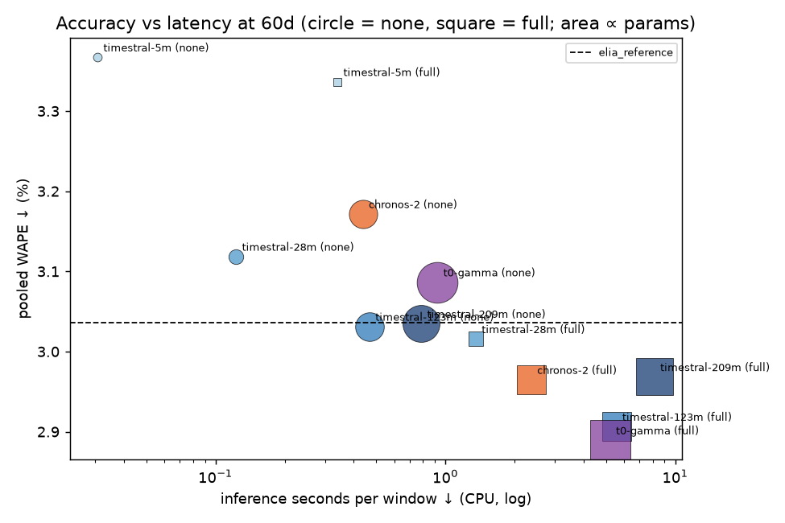

# leaderboard

| data | SHA-256 |
|:--|:--|
| processed dataset `data/processed/elia_2024_2025.parquet` (input of every run) | `5863d97670fe6ec7ab1445125eef3941b8bf4b1aaaa4c2f25253645c33b6db81` |
| raw load `data/load.csv` (Elia ods001) | `e57db353662d0406ff5f75deccbb602b2bf104869e905cc0df0e5083a6f39188` |
| raw weather `data/weather_cov.csv` (Open-Meteo) | `73f6a63335b20eabcaef141c2fceaf83c860cf51e58571a69ba35709a27d7bfe` |

Windows per run: 365 (every day of 2025)  |  CPU threads: [8]  |  bootstrap: 2000 resamples of days, seed 42

Caveat: Open-Meteo has no issue timestamps; availability of the temperature covariate at 18:00 the day before cannot be proven.

## Acceptance gates

- **elia_reference pooled WAPE on 2025**: 3.0358% (target 3.036% ± 0.001) → **PASS**
- **Complete windows**: every aggregated run has 365/365 windows (aggregation refuses otherwise)

Leakage dates: 2025-03-15 (normal), 2025-03-30 and 2025-10-26 (DST), 2025-05-01 and 2025-12-25 (holidays). Determinism: 8 windows run twice, all stored quantiles compared. Re-run with `bench gates --config <experiment>`; stale = revision or adapter_version changed since recording.

| model                   | leakage (noise after 17:45)   | leakage setting   | determinism (2 runs, bit-identical)   | determinism setting   | note   | recorded (UTC)   |
|:------------------------|:------------------------------|:------------------|:--------------------------------------|:----------------------|:-------|:-----------------|
| timestral-5m            | PASS                          | full, ctx 30      | PASS                                  | full, ctx 15          |        | 2026-10-20T09:56 |
| timestral-28m           | PASS                          | full, ctx 30      | PASS                                  | full, ctx 15          |        | 2026-10-20T09:57 |
| timestral-123m          | PASS                          | full, ctx 30      | PASS                                  | full, ctx 15          |        | 2026-10-20T09:58 |
| chronos-2               | PASS                          | full, ctx 30      | PASS                                  | full, ctx 15          |        | 2026-10-20T09:56 |
| timestral-209m          | PASS                          | full, ctx 30      | PASS                                  | full, ctx 15          |        | 2026-10-20T09:59 |
| t0-gamma                | PASS                          | full, ctx 30      | PASS                                  | full, ctx 15          |        | 2026-10-20T16:18 |
| elia_reference          | PASS                          | default, ctx -    | PASS                                  | default, ctx -        |        | 2026-10-20T09:59 |
| last_value              | PASS                          | default, ctx -    | PASS                                  | default, ctx -        |        | 2026-10-20T09:59 |
| daily_persistence       | PASS                          | default, ctx -    | PASS                                  | default, ctx -        |        | 2026-10-20T09:59 |
| weekly_persistence      | PASS                          | default, ctx -    | PASS                                  | default, ctx -        |        | 2026-10-20T09:59 |
| seasonal_moving_average | PASS                          | default, ctx -    | PASS                                  | default, ctx -        |        | 2026-10-20T10:00 |
| exp_weighted_seasonal   | PASS                          | default, ctx -    | PASS                                  | default, ctx -        |        | 2026-10-20T10:00 |

## Leaderboard
MW for MAE, RMSE, width, pinball, CRPS≈. Point metrics use P50, pooled over all scored points. eff. ctx = context actually fed to the model (baselines: days their definition needs). CRPS≈ = 2 × mean pinball over the common quantile set 0.1..0.9 (only where all 9 levels exist; the Elia reference has only 0.1/0.5/0.9, so compare it via the P10/50/90 pinball column).

| model                   | covariates   | ctx (days)   |   eff. ctx (days) |   WAPE (pooled) ↓ % |   CI95 lo % |   CI95 hi % |   median-window WAPE ↓ % |   MAE ↓ |   RMSE ↓ |   sMAPE ↓ % |   P10-P90 coverage % (target 80) |   width ↓ |   pinball mean(0.1..0.9) ↓ |   pinball P10/50/90 ↓ |   CRPS≈ ↓ |
|:------------------------|:-------------|:-------------|------------------:|--------------------:|------------:|------------:|-------------------------:|--------:|---------:|------------:|---------------------------------:|----------:|---------------------------:|----------------------:|----------:|
| timestral-123m          | full         | 75           |             75    |                2.88 |        2.67 |        3.09 |                     2.32 |  263.27 |   371.44 |        2.88 |                            81.34 |    858.08 |                     104.07 |                 85.62 |    208.14 |
| timestral-123m          | full         | 90           |             90    |                2.88 |        2.67 |        3.09 |                     2.32 |  263.47 |   370.28 |        2.88 |                            81.58 |    870.64 |                     103.99 |                 85.45 |    207.97 |
| t0-gamma                | full         | 75           |             75    |                2.88 |        2.68 |        3.1  |                     2.2  |  264    |   367.74 |        2.89 |                            79.58 |    863.13 |                     105.05 |                 86.64 |    210.09 |
| t0-gamma                | full         | 60           |             60    |                2.89 |        2.68 |        3.1  |                     2.24 |  264.53 |   368.01 |        2.9  |                            79.72 |    871.62 |                     105.2  |                 86.61 |    210.41 |
| t0-gamma                | full         | 90           |             85.33 |                2.89 |        2.68 |        3.11 |                     2.24 |  264.75 |   367.44 |        2.9  |                            79.52 |    854.2  |                     104.86 |                 86.26 |    209.72 |
| timestral-123m          | full         | 60           |             60    |                2.91 |        2.69 |        3.12 |                     2.31 |  266.08 |   374.92 |        2.91 |                            81.02 |    858.61 |                     105.07 |                 86.45 |    210.14 |
| t0-gamma                | full         | 45           |             45    |                2.93 |        2.73 |        3.15 |                     2.29 |  268.68 |   374.39 |        2.94 |                            79.38 |    870.58 |                     106.82 |                 88.11 |    213.63 |
| chronos-2               | full         | 60           |             60    |                2.96 |        2.75 |        3.17 |                     2.38 |  271.42 |   374.86 |        2.96 |                            77.67 |    824.97 |                     107.11 |                 87.95 |    214.23 |
| timestral-209m          | full         | 60           |             60    |                2.97 |        2.75 |        3.19 |                     2.35 |  271.74 |   384.93 |        2.97 |                            82.21 |    932.9  |                     107.89 |                 88.91 |    215.78 |
| timestral-209m          | full         | 75           |             75    |                2.97 |        2.75 |        3.2  |                     2.34 |  272.12 |   386.01 |        2.97 |                            81.93 |    935.13 |                     108.29 |                 89.25 |    216.58 |
| chronos-2               | full         | 90           |             85.33 |                2.97 |        2.76 |        3.18 |                     2.42 |  272.17 |   375.99 |        2.97 |                            78.76 |    855.38 |                     107.55 |                 88.33 |    215.1  |
| chronos-2               | full         | 45           |             45    |                2.98 |        2.77 |        3.18 |                     2.4  |  272.39 |   375.74 |        2.97 |                            76.33 |    797.48 |                     107.48 |                 88.3  |    214.95 |
| chronos-2               | full         | 75           |             75    |                2.98 |        2.76 |        3.19 |                     2.42 |  272.59 |   376.61 |        2.98 |                            78.01 |    835.42 |                     107.57 |                 88.3  |    215.13 |
| timestral-123m          | full         | 45           |             45    |                2.99 |        2.77 |        3.21 |                     2.34 |  273.32 |   385.46 |        2.99 |                            80.25 |    853.7  |                     107.69 |                 88.66 |    215.38 |
| timestral-209m          | full         | 45           |             45    |                2.99 |        2.77 |        3.22 |                     2.41 |  273.85 |   391.12 |        2.99 |                            81.86 |    923.58 |                     108.98 |                 89.93 |    217.95 |
| chronos-2               | full         | 30           |             30    |                3    |        2.79 |        3.2  |                     2.38 |  274.36 |   380.11 |        3    |                            75.07 |    775.48 |                     108.31 |                 89.01 |    216.61 |
| timestral-209m          | full         | 90           |             90    |                3    |        2.79 |        3.23 |                     2.38 |  274.83 |   388.21 |        3    |                            81.85 |    940.36 |                     109.2  |                 90.09 |    218.4  |
| timestral-123m          | none         | 75           |             75    |                3.01 |        2.78 |        3.25 |                     2.31 |  275.42 |   394.02 |        3    |                            79.01 |    831.99 |                     109.65 |                 90.74 |    219.29 |
| timestral-123m          | none         | 90           |             90    |                3.01 |        2.78 |        3.25 |                     2.34 |  275.49 |   394.21 |        3    |                            79.57 |    840.71 |                     109.48 |                 90.53 |    218.96 |
| timestral-28m           | full         | 60           |             60    |                3.02 |        2.78 |        3.25 |                     2.29 |  276.08 |   393.59 |        3.01 |                            81.02 |    902.76 |                     110.01 |                 91.13 |    220.02 |
| timestral-28m           | full         | 75           |             75    |                3.02 |        2.78 |        3.25 |                     2.3  |  276.27 |   393.47 |        3.02 |                            80.71 |    893.29 |                     109.93 |                 91.05 |    219.86 |
| timestral-28m           | full         | 90           |             90    |                3.02 |        2.79 |        3.26 |                     2.28 |  276.64 |   394.24 |        3.02 |                            80.6  |    889.81 |                     110.02 |                 91.07 |    220.05 |
| timestral-209m          | full         | 30           |             30    |                3.02 |        2.8  |        3.25 |                     2.43 |  276.67 |   391.89 |        3.02 |                            82.33 |    954.17 |                     110    |                 90.73 |    220.01 |
| timestral-209m          | none         | 75           |             75    |                3.02 |        2.78 |        3.27 |                     2.32 |  276.83 |   398.4  |        3.02 |                            79.84 |    856.84 |                     109.94 |                 90.63 |    219.88 |
| timestral-209m          | none         | 90           |             90    |                3.02 |        2.78 |        3.27 |                     2.3  |  276.83 |   399.06 |        3.02 |                            79.64 |    851.94 |                     109.93 |                 90.64 |    219.85 |
| timestral-123m          | none         | 60           |             60    |                3.03 |        2.8  |        3.27 |                     2.31 |  277.49 |   395.85 |        3.02 |                            79.08 |    840.23 |                     110.45 |                 91.28 |    220.89 |
| timestral-209m          | none         | 60           |             60    |                3.03 |        2.8  |        3.28 |                     2.31 |  277.83 |   398.84 |        3.03 |                            79.82 |    858.74 |                     110.45 |                 91.07 |    220.89 |
| elia_reference          | -            | -            |              0    |                3.04 |        2.85 |        3.23 |                     2.55 |  277.92 |   371.48 |        3.01 |                            75.47 |    831.71 |                      90.27 |                 90.27 |    nan    |
| timestral-123m          | full         | 30           |             30    |                3.04 |        2.81 |        3.26 |                     2.4  |  278.24 |   390.03 |        3.04 |                            80.99 |    897.67 |                     109.6  |                 90.08 |    219.2  |
| timestral-209m          | none         | 45           |             45    |                3.05 |        2.82 |        3.3  |                     2.32 |  279.58 |   400.99 |        3.04 |                            79.6  |    861.29 |                     111.36 |                 91.96 |    222.71 |
| timestral-28m           | full         | 45           |             45    |                3.05 |        2.83 |        3.29 |                     2.34 |  279.63 |   395.26 |        3.05 |                            81.48 |    919.05 |                     111.11 |                 91.84 |    222.22 |
| timestral-123m          | none         | 45           |             45    |                3.07 |        2.83 |        3.31 |                     2.41 |  280.6  |   399.11 |        3.06 |                            79.1  |    848.65 |                     111.66 |                 92.32 |    223.32 |
| t0-gamma                | full         | 30           |             30    |                3.08 |        2.87 |        3.3  |                     2.38 |  281.96 |   389.27 |        3.08 |                            79.72 |    928.12 |                     111.09 |                 91.16 |    222.18 |
| t0-gamma                | none         | 60           |             60    |                3.09 |        2.85 |        3.33 |                     2.41 |  282.56 |   402.59 |        3.08 |                            77.73 |    831.86 |                     112.16 |                 92.67 |    224.31 |
| timestral-28m           | none         | 90           |             90    |                3.09 |        2.86 |        3.34 |                     2.39 |  283.3  |   400.08 |        3.08 |                            79.76 |    880.9  |                     112.43 |                 92.98 |    224.87 |
| t0-gamma                | none         | 75           |             75    |                3.1  |        2.86 |        3.34 |                     2.4  |  283.53 |   404.23 |        3.09 |                            78.24 |    840.97 |                     112.48 |                 92.98 |    224.96 |
| timestral-28m           | none         | 75           |             75    |                3.1  |        2.87 |        3.34 |                     2.41 |  283.73 |   400.22 |        3.09 |                            79.69 |    883.7  |                     112.66 |                 93.19 |    225.33 |
| timestral-209m          | none         | 30           |             30    |                3.1  |        2.86 |        3.35 |                     2.39 |  283.89 |   403.89 |        3.09 |                            80.58 |    917.71 |                     112.87 |                 93.05 |    225.74 |
| t0-gamma                | none         | 90           |             85.33 |                3.1  |        2.86 |        3.35 |                     2.44 |  283.9  |   404.13 |        3.09 |                            78.51 |    848.09 |                     112.54 |                 92.98 |    225.09 |
| timestral-28m           | none         | 60           |             60    |                3.12 |        2.88 |        3.36 |                     2.4  |  285.49 |   401.68 |        3.11 |                            79.5  |    891.13 |                     113.29 |                 93.62 |    226.59 |
| t0-gamma                | none         | 45           |             45    |                3.12 |        2.88 |        3.36 |                     2.44 |  285.57 |   405.51 |        3.11 |                            77.61 |    837.85 |                     113.1  |                 93.32 |    226.21 |
| timestral-28m           | full         | 30           |             30    |                3.12 |        2.89 |        3.37 |                     2.39 |  285.83 |   402.84 |        3.12 |                            81.37 |    949.53 |                     113.68 |                 93.95 |    227.36 |
| timestral-123m          | none         | 30           |             30    |                3.13 |        2.89 |        3.37 |                     2.43 |  286.56 |   404.49 |        3.12 |                            80.62 |    921.89 |                     113.84 |                 93.83 |    227.67 |
| chronos-2               | none         | 30           |             30    |                3.14 |        2.9  |        3.38 |                     2.44 |  287.48 |   407.71 |        3.13 |                            76.4  |    849.92 |                     114.85 |                 95.03 |    229.69 |
| chronos-2               | none         | 45           |             45    |                3.14 |        2.9  |        3.39 |                     2.44 |  287.82 |   407.99 |        3.13 |                            78    |    893.62 |                     115.14 |                 95.24 |    230.29 |
| timestral-28m           | none         | 45           |             45    |                3.15 |        2.92 |        3.38 |                     2.44 |  288.32 |   404.48 |        3.14 |                            79.54 |    898.67 |                     114.33 |                 94.41 |    228.66 |
| chronos-2               | none         | 60           |             60    |                3.17 |        2.93 |        3.42 |                     2.48 |  290.35 |   411.1  |        3.16 |                            79.39 |    935.8  |                     116.17 |                 96.02 |    232.34 |
| chronos-2               | none         | 75           |             75    |                3.19 |        2.94 |        3.44 |                     2.5  |  291.61 |   412.84 |        3.17 |                            79.93 |    955.6  |                     116.76 |                 96.51 |    233.52 |
| chronos-2               | none         | 90           |             85.33 |                3.19 |        2.94 |        3.44 |                     2.49 |  292.04 |   413.33 |        3.18 |                            80.68 |    980.98 |                     117.03 |                 96.73 |    234.07 |
| t0-gamma                | none         | 30           |             30    |                3.2  |        2.96 |        3.45 |                     2.51 |  293.34 |   411.8  |        3.19 |                            78.38 |    893.14 |                     115.89 |                 95.35 |    231.78 |
| timestral-28m           | none         | 30           |             30    |                3.21 |        2.97 |        3.45 |                     2.54 |  293.54 |   409.01 |        3.19 |                            80.37 |    939.02 |                     116.09 |                 95.71 |    232.17 |
| timestral-5m            | full         | 90           |             90    |                3.29 |        3.06 |        3.54 |                     2.56 |  301.16 |   418.64 |        3.28 |                            78.6  |    901.74 |                     118.78 |                 97.97 |    237.57 |
| chronos-2               | none         | 15           |             15    |                3.29 |        3.04 |        3.55 |                     2.58 |  301.36 |   427.03 |        3.28 |                            75.6  |    874.24 |                     119.78 |                 99.01 |    239.57 |
| timestral-5m            | full         | 75           |             75    |                3.3  |        3.06 |        3.54 |                     2.59 |  301.93 |   419.34 |        3.29 |                            78.67 |    903.75 |                     118.98 |                 98.1  |    237.96 |
| chronos-2               | full         | 15           |             15    |                3.31 |        3.07 |        3.55 |                     2.51 |  302.71 |   422.35 |        3.31 |                            74.87 |    846.64 |                     119.28 |                 97.78 |    238.56 |
| timestral-209m          | full         | 15           |             15    |                3.31 |        3.06 |        3.57 |                     2.54 |  303.2  |   427.31 |        3.32 |                            83.34 |   1059.64 |                     119.48 |                 98.17 |    238.96 |
| timestral-5m            | none         | 75           |             75    |                3.31 |        3.07 |        3.55 |                     2.65 |  303.46 |   420.15 |        3.3  |                            81    |    959.46 |                     119.58 |                 98.59 |    239.15 |
| timestral-5m            | none         | 90           |             90    |                3.32 |        3.07 |        3.56 |                     2.69 |  303.56 |   420.16 |        3.3  |                            80.8  |    953.62 |                     119.62 |                 98.6  |    239.24 |
| timestral-5m            | full         | 45           |             45    |                3.33 |        3.1  |        3.57 |                     2.65 |  304.9  |   421.65 |        3.33 |                            77.73 |    897.52 |                     119.89 |                 98.71 |    239.78 |
| timestral-5m            | full         | 60           |             60    |                3.34 |        3.1  |        3.57 |                     2.63 |  305.44 |   422.74 |        3.33 |                            78.03 |    907.11 |                     120.17 |                 98.96 |    240.34 |
| timestral-5m            | none         | 45           |             45    |                3.37 |        3.12 |        3.61 |                     2.62 |  308.08 |   426.37 |        3.35 |                            80.03 |    960.01 |                     121.25 |                 99.87 |    242.5  |
| timestral-5m            | none         | 60           |             60    |                3.37 |        3.13 |        3.61 |                     2.65 |  308.25 |   425.68 |        3.35 |                            80.41 |    965.98 |                     121.23 |                 99.79 |    242.46 |
| timestral-5m            | full         | 30           |             30    |                3.37 |        3.14 |        3.61 |                     2.62 |  308.67 |   426.36 |        3.36 |                            77.81 |    916.03 |                     121.28 |                 99.67 |    242.57 |
| timestral-209m          | none         | 15           |             15    |                3.38 |        3.12 |        3.65 |                     2.63 |  309.15 |   437.64 |        3.37 |                            81.04 |   1015.87 |                     122.52 |                100.98 |    245.05 |
| timestral-123m          | full         | 15           |             15    |                3.38 |        3.11 |        3.64 |                     2.57 |  309.17 |   434.19 |        3.38 |                            80.88 |    996.11 |                     122.05 |                100.51 |    244.09 |
| timestral-5m            | none         | 30           |             30    |                3.4  |        3.15 |        3.65 |                     2.63 |  311.25 |   431.54 |        3.39 |                            79.92 |    976.72 |                     122.56 |                100.91 |    245.13 |
| t0-gamma                | full         | 15           |             15    |                3.42 |        3.17 |        3.66 |                     2.7  |  312.69 |   431.4  |        3.41 |                            79.48 |   1022.17 |                     122.96 |                100.35 |    245.91 |
| timestral-123m          | none         | 15           |             15    |                3.52 |        3.26 |        3.79 |                     2.74 |  322.3  |   449.6  |        3.52 |                            80.37 |   1039.79 |                     127.39 |                104.6  |    254.79 |
| timestral-28m           | full         | 15           |             15    |                3.54 |        3.26 |        3.82 |                     2.8  |  324.06 |   453.75 |        3.54 |                            82.47 |   1118.43 |                     128.5  |                106.05 |    257    |
| t0-gamma                | none         | 15           |             15    |                3.56 |        3.3  |        3.83 |                     2.74 |  325.6  |   452.32 |        3.55 |                            79.85 |   1049.6  |                     128.52 |                105.34 |    257.04 |
| timestral-28m           | none         | 15           |             15    |                3.59 |        3.33 |        3.84 |                     2.91 |  328.33 |   451.64 |        3.57 |                            82.52 |   1123.03 |                     129.45 |                106.67 |    258.9  |
| timestral-5m            | full         | 15           |             15    |                3.76 |        3.5  |        4.01 |                     2.95 |  343.95 |   469.57 |        3.75 |                            77.09 |   1026.49 |                     134.8  |                110.36 |    269.59 |
| timestral-5m            | none         | 15           |             15    |                3.78 |        3.51 |        4.05 |                     2.91 |  345.96 |   472.94 |        3.76 |                            77.2  |   1028.49 |                     135.56 |                111.1  |    271.11 |
| exp_weighted_seasonal   | -            | -            |            198    |                3.84 |        3.57 |        4.12 |                     3    |  351.48 |   463.68 |        3.85 |                           nan    |    nan    |                     175.74 |                nan    |    nan    |
| seasonal_moving_average | -            | -            |             51    |                4.24 |        3.94 |        4.56 |                     3.21 |  388.33 |   513.01 |        4.24 |                           nan    |    nan    |                     194.17 |                nan    |    nan    |
| weekly_persistence      | -            | -            |              8    |                4.99 |        4.6  |        5.39 |                     3.61 |  456.47 |   638.1  |        4.96 |                           nan    |    nan    |                     228.24 |                nan    |    nan    |
| daily_persistence       | -            | -            |              3    |                6.21 |        5.81 |        6.63 |                     5.08 |  568.66 |   780.43 |        6.22 |                           nan    |    nan    |                     284.33 |                nan    |    nan    |
| last_value              | -            | -            |              1    |               12.22 |       11.84 |       12.59 |                    11.55 | 1118.29 |  1411.78 |       12.02 |                           nan    |    nan    |                     559.14 |                nan    |    nan    |

## Size curve (Timestral sizes at 60d context, chronos-2 as reference)
CPU latency on this machine (threads in the header). Mistral claims Timestral-28M beats Chronos-2: compare the Δ column at matching covariates. Δ < 0 = better than the reference.

| model          |   params (M) | covariates   |   WAPE ↓ % | Δ WAPE vs chronos-2 (pp)   |   CRPS≈ ↓ MW |   per window ↓ s |   total inference ↓ s |
|:---------------|-------------:|:-------------|-----------:|:---------------------------|-------------:|-----------------:|----------------------:|
| timestral-5m   |         5.21 | full         |       3.34 | 0.37                       |        240.3 |              0.3 |                   124 |
| timestral-28m  |        27.8  | full         |       3.02 | 0.05                       |        220   |              1   |                   496 |
| chronos-2      |       120    | full         |       2.96 | ref                        |        214.2 |              2   |                   865 |
| timestral-123m |       123    | full         |       2.91 | -0.06                      |        210.1 |              6   |                  2029 |
| timestral-209m |       209    | full         |       2.97 | 0.0                        |        215.8 |              8   |                  2967 |
| timestral-5m   |         5.21 | none         |       3.37 | 0.2                        |        242.5 |              0   |                    11 |
| timestral-28m  |        27.8  | none         |       3.12 | -0.05                      |        226.6 |              0.1 |                    45 |
| chronos-2      |       120    | none         |       3.17 | ref                        |        232.3 |              0.4 |                   160 |
| timestral-123m |       123    | none         |       3.03 | -0.14                      |        220.9 |              0.5 |                   171 |
| timestral-209m |       209    | none         |       3.03 | -0.14                      |        220.9 |              0.8 |                   287 |

## Context sweep (pooled WAPE ↓ %, by configured context)
Where effective context differs from configured (e.g. a model maximum), the leaderboard's eff. ctx column shows it.

| model          | covariates   |   15d |   30d |   45d |   60d |   75d |   90d |
|:---------------|:-------------|------:|------:|------:|------:|------:|------:|
| chronos-2      | full         |  3.31 |  3    |  2.98 |  2.96 |  2.98 |  2.97 |
| chronos-2      | none         |  3.29 |  3.14 |  3.14 |  3.17 |  3.19 |  3.19 |
| t0-gamma       | full         |  3.42 |  3.08 |  2.93 |  2.89 |  2.88 |  2.89 |
| t0-gamma       | none         |  3.56 |  3.2  |  3.12 |  3.09 |  3.1  |  3.1  |
| timestral-123m | full         |  3.38 |  3.04 |  2.99 |  2.91 |  2.88 |  2.88 |
| timestral-123m | none         |  3.52 |  3.13 |  3.07 |  3.03 |  3.01 |  3.01 |
| timestral-209m | full         |  3.31 |  3.02 |  2.99 |  2.97 |  2.97 |  3    |
| timestral-209m | none         |  3.38 |  3.1  |  3.05 |  3.03 |  3.02 |  3.02 |
| timestral-28m  | full         |  3.54 |  3.12 |  3.05 |  3.02 |  3.02 |  3.02 |
| timestral-28m  | none         |  3.59 |  3.21 |  3.15 |  3.12 |  3.1  |  3.09 |
| timestral-5m   | full         |  3.76 |  3.37 |  3.33 |  3.34 |  3.3  |  3.29 |
| timestral-5m   | none         |  3.78 |  3.4  |  3.37 |  3.37 |  3.31 |  3.32 |

## Covariate effect (WAPE ↓ %; negative last column = covariates help)

| model          |   ctx (days) |   full |   none |   full − none (pp) |
|:---------------|-------------:|-------:|-------:|-------------------:|
| chronos-2      |           15 |   3.31 |   3.29 |               0.01 |
| chronos-2      |           30 |   3    |   3.14 |              -0.14 |
| chronos-2      |           45 |   2.98 |   3.14 |              -0.17 |
| chronos-2      |           60 |   2.96 |   3.17 |              -0.21 |
| chronos-2      |           75 |   2.98 |   3.19 |              -0.21 |
| chronos-2      |           90 |   2.97 |   3.19 |              -0.22 |
| t0-gamma       |           15 |   3.42 |   3.56 |              -0.14 |
| t0-gamma       |           30 |   3.08 |   3.2  |              -0.12 |
| t0-gamma       |           45 |   2.93 |   3.12 |              -0.18 |
| t0-gamma       |           60 |   2.89 |   3.09 |              -0.2  |
| t0-gamma       |           75 |   2.88 |   3.1  |              -0.21 |
| t0-gamma       |           90 |   2.89 |   3.1  |              -0.21 |
| timestral-123m |           15 |   3.38 |   3.52 |              -0.14 |
| timestral-123m |           30 |   3.04 |   3.13 |              -0.09 |
| timestral-123m |           45 |   2.99 |   3.07 |              -0.08 |
| timestral-123m |           60 |   2.91 |   3.03 |              -0.12 |
| timestral-123m |           75 |   2.88 |   3.01 |              -0.13 |
| timestral-123m |           90 |   2.88 |   3.01 |              -0.13 |
| timestral-209m |           15 |   3.31 |   3.38 |              -0.07 |
| timestral-209m |           30 |   3.02 |   3.1  |              -0.08 |
| timestral-209m |           45 |   2.99 |   3.05 |              -0.06 |
| timestral-209m |           60 |   2.97 |   3.03 |              -0.07 |
| timestral-209m |           75 |   2.97 |   3.02 |              -0.05 |
| timestral-209m |           90 |   3    |   3.02 |              -0.02 |
| timestral-28m  |           15 |   3.54 |   3.59 |              -0.05 |
| timestral-28m  |           30 |   3.12 |   3.21 |              -0.08 |
| timestral-28m  |           45 |   3.05 |   3.15 |              -0.09 |
| timestral-28m  |           60 |   3.02 |   3.12 |              -0.1  |
| timestral-28m  |           75 |   3.02 |   3.1  |              -0.08 |
| timestral-28m  |           90 |   3.02 |   3.09 |              -0.07 |
| timestral-5m   |           15 |   3.76 |   3.78 |              -0.02 |
| timestral-5m   |           30 |   3.37 |   3.4  |              -0.03 |
| timestral-5m   |           45 |   3.33 |   3.37 |              -0.03 |
| timestral-5m   |           60 |   3.34 |   3.37 |              -0.03 |
| timestral-5m   |           75 |   3.3  |   3.31 |              -0.02 |
| timestral-5m   |           90 |   3.29 |   3.32 |              -0.03 |

## Slices (pooled WAPE ↓ %)
weekday = Mon–Fri non-holiday; weekend = Sat/Sun; holiday_weekday = public holiday on Mon–Fri; non_holiday = all non-holiday days.

| model                   | covariates   | ctx (days)   |   holiday_weekday |   non_holiday |   weekday |   weekend |   month_01 |   month_02 |   month_03 |   month_04 |   month_05 |   month_06 |   month_07 |   month_08 |   month_09 |   month_10 |   month_11 |   month_12 |
|:------------------------|:-------------|:-------------|------------------:|--------------:|----------:|----------:|-----------:|-----------:|-----------:|-----------:|-----------:|-----------:|-----------:|-----------:|-----------:|-----------:|-----------:|-----------:|
| chronos-2               | full         | 15           |              9.93 |          3.15 |      3.03 |      3.52 |       3.13 |       2.2  |       3.57 |       4.08 |       3.46 |       3.21 |       2.86 |       2.85 |       2.42 |       3.01 |       5.48 |       3.41 |
| chronos-2               | full         | 30           |              8.35 |          2.87 |      2.82 |      3.02 |       2.79 |       2.11 |       3.33 |       3.19 |       2.91 |       2.96 |       2.66 |       2.48 |       2.3  |       2.86 |       4.96 |       3.35 |
| chronos-2               | full         | 45           |              7.42 |          2.87 |      2.82 |      3.03 |       2.78 |       2.04 |       3.29 |       3.33 |       2.86 |       2.95 |       2.45 |       2.49 |       2.31 |       2.85 |       4.97 |       3.31 |
| chronos-2               | full         | 60           |              7.06 |          2.87 |      2.81 |      3.04 |       2.75 |       2.04 |       3.28 |       3.34 |       2.87 |       2.95 |       2.46 |       2.44 |       2.32 |       2.84 |       5.01 |       3.22 |
| chronos-2               | full         | 75           |              7.2  |          2.88 |      2.82 |      3.05 |       2.77 |       2.04 |       3.28 |       3.37 |       2.88 |       2.95 |       2.48 |       2.47 |       2.32 |       2.84 |       5.06 |       3.21 |
| chronos-2               | full         | 90           |              7.26 |          2.87 |      2.82 |      3.04 |       2.76 |       2.02 |       3.28 |       3.39 |       2.89 |       2.94 |       2.47 |       2.47 |       2.32 |       2.85 |       5.05 |       3.19 |
| chronos-2               | none         | 15           |             12.12 |          3.09 |      3.15 |      2.95 |       3.67 |       2.59 |       3.46 |       3.8  |       3.19 |       3.02 |       2.99 |       2.98 |       2.27 |       2.82 |       5.24 |       3.35 |
| chronos-2               | none         | 30           |             11.88 |          2.95 |      3    |      2.81 |       3.24 |       2.63 |       3.42 |       3.45 |       3.03 |       2.86 |       2.8  |       2.89 |       2.21 |       2.89 |       4.95 |       3.21 |
| chronos-2               | none         | 45           |             11.85 |          2.95 |      3.01 |      2.8  |       3.16 |       2.65 |       3.32 |       3.53 |       2.99 |       2.93 |       2.81 |       2.93 |       2.25 |       2.87 |       4.98 |       3.24 |
| chronos-2               | none         | 60           |             11.69 |          2.98 |      3.05 |      2.81 |       3.2  |       2.73 |       3.29 |       3.58 |       3.02 |       2.96 |       2.85 |       2.95 |       2.27 |       2.86 |       4.99 |       3.27 |
| chronos-2               | none         | 75           |             11.68 |          3    |      3.06 |      2.82 |       3.23 |       2.75 |       3.28 |       3.57 |       3.02 |       2.97 |       2.88 |       2.98 |       2.28 |       2.87 |       5.02 |       3.3  |
| chronos-2               | none         | 90           |             11.67 |          3    |      3.07 |      2.82 |       3.24 |       2.74 |       3.26 |       3.57 |       3.03 |       2.98 |       2.89 |       2.99 |       2.29 |       2.87 |       5.04 |       3.3  |
| daily_persistence       | -            | -            |              9.24 |          6.13 |      5.48 |      7.95 |       5.8  |       5.23 |       6.68 |       6.5  |       6.23 |       6.06 |       5.86 |       6.51 |       6.34 |       6.27 |       7.28 |       5.89 |
| elia_reference          | -            | -            |              3.42 |          3.02 |      3.12 |      2.78 |       2.69 |       2.54 |       3.85 |       3.6  |       2.35 |       2.47 |       2.79 |       2.29 |       2.48 |       2.82 |       4.43 |       3.96 |
| exp_weighted_seasonal   | -            | -            |              4.07 |          3.83 |      3.58 |      4.52 |       4.76 |       3.57 |       5.86 |       4.11 |       2.94 |       2.81 |       3.43 |       3.42 |       2.47 |       3.31 |       5.97 |       3.09 |
| last_value              | -            | -            |             15.52 |         12.13 |     11.52 |     13.84 |      14.25 |      12.24 |      11.09 |      10.06 |      10.6  |      10.59 |      10.1  |      11.31 |      12.82 |      13.34 |      14.51 |      14.55 |
| seasonal_moving_average | -            | -            |              4.13 |          4.24 |      3.87 |      5.24 |       5.55 |       4.19 |       6.94 |       4.59 |       2.99 |       2.91 |       3.68 |       3.88 |       2.73 |       3.22 |       6.45 |       3.34 |
| t0-gamma                | full         | 15           |              9.93 |          3.27 |      3.28 |      3.25 |       3.7  |       2.6  |       3.68 |       3.72 |       3.38 |       3.19 |       3.15 |       3.33 |       2.59 |       2.94 |       5.36 |       3.27 |
| t0-gamma                | full         | 30           |              9.73 |          2.92 |      2.96 |      2.86 |       2.96 |       2.47 |       3.34 |       3.34 |       3.07 |       2.87 |       2.61 |       2.97 |       2.37 |       2.85 |       4.91 |       3.15 |
| t0-gamma                | full         | 45           |              9.03 |          2.78 |      2.81 |      2.78 |       2.57 |       2.29 |       3.21 |       3.27 |       2.85 |       2.67 |       2.62 |       2.67 |       2.36 |       2.82 |       4.92 |       2.96 |
| t0-gamma                | full         | 60           |              7.73 |          2.76 |      2.81 |      2.71 |       2.52 |       2.25 |       3.1  |       3.36 |       2.73 |       2.44 |       2.69 |       2.52 |       2.35 |       2.8  |       4.98 |       2.9  |
| t0-gamma                | full         | 75           |              7.16 |          2.76 |      2.8  |      2.75 |       2.54 |       2.09 |       3.12 |       3.45 |       2.69 |       2.47 |       2.5  |       2.74 |       2.31 |       2.78 |       4.98 |       2.92 |
| t0-gamma                | full         | 90           |              6.56 |          2.79 |      2.83 |      2.75 |       2.64 |       2.13 |       3.21 |       3.37 |       2.68 |       2.43 |       2.51 |       2.67 |       2.31 |       2.79 |       5.08 |       2.85 |
| t0-gamma                | none         | 15           |             11.45 |          3.38 |      3.4  |      3.33 |       4.02 |       2.97 |       3.7  |       3.83 |       3.67 |       3.28 |       3.51 |       3.64 |       2.42 |       2.88 |       5.5  |       3.2  |
| t0-gamma                | none         | 30           |             12.31 |          3    |      3.04 |      2.89 |       3.5  |       2.74 |       3.37 |       3.45 |       3.15 |       2.83 |       2.99 |       3.04 |       2.3  |       2.88 |       5.04 |       3.05 |
| t0-gamma                | none         | 45           |             12.45 |          2.92 |      2.98 |      2.73 |       3.13 |       2.65 |       3.39 |       3.45 |       3.05 |       2.76 |       2.88 |       2.86 |       2.28 |       2.83 |       4.99 |       3.08 |
| t0-gamma                | none         | 60           |             12.38 |          2.88 |      2.95 |      2.68 |       3.1  |       2.59 |       3.33 |       3.41 |       2.97 |       2.7  |       2.84 |       2.82 |       2.29 |       2.8  |       5.08 |       3.02 |
| t0-gamma                | none         | 75           |             12.3  |          2.9  |      2.96 |      2.72 |       3.2  |       2.51 |       3.33 |       3.47 |       3    |       2.72 |       2.84 |       2.95 |       2.29 |       2.77 |       5.05 |       2.97 |
| t0-gamma                | none         | 90           |             12.14 |          2.9  |      2.98 |      2.7  |       3.23 |       2.51 |       3.36 |       3.45 |       2.97 |       2.71 |       2.88 |       2.9  |       2.3  |       2.78 |       5.08 |       2.95 |
| timestral-123m          | full         | 15           |             10.4  |          3.22 |      3.22 |      3.24 |       3.29 |       2.54 |       3.45 |       3.8  |       3.59 |       3.18 |       3.23 |       3.1  |       2.51 |       2.92 |       5.49 |       3.42 |
| timestral-123m          | full         | 30           |              9.96 |          2.89 |      2.91 |      2.83 |       2.6  |       2.35 |       3.17 |       3.4  |       3.03 |       2.69 |       2.71 |       2.88 |       2.45 |       2.84 |       5.14 |       3.21 |
| timestral-123m          | full         | 45           |              9.69 |          2.84 |      2.85 |      2.8  |       2.57 |       2.3  |       3.12 |       3.35 |       2.79 |       2.72 |       2.61 |       2.7  |       2.53 |       2.77 |       5.19 |       3.15 |
| timestral-123m          | full         | 60           |              8.7  |          2.78 |      2.79 |      2.75 |       2.32 |       2.27 |       3.11 |       3.32 |       2.64 |       2.6  |       2.52 |       2.61 |       2.46 |       2.8  |       5.15 |       3.08 |
| timestral-123m          | full         | 75           |              7.78 |          2.77 |      2.78 |      2.74 |       2.23 |       2.22 |       3.19 |       3.35 |       2.57 |       2.53 |       2.38 |       2.64 |       2.45 |       2.79 |       5.17 |       2.99 |
| timestral-123m          | full         | 90           |              7.57 |          2.77 |      2.79 |      2.73 |       2.18 |       2.21 |       3.22 |       3.37 |       2.58 |       2.48 |       2.44 |       2.61 |       2.43 |       2.8  |       5.19 |       3.03 |
| timestral-123m          | none         | 15           |             11.06 |          3.35 |      3.36 |      3.34 |       3.82 |       2.83 |       3.57 |       4.02 |       3.81 |       3.29 |       3.46 |       3.23 |       2.43 |       2.96 |       5.32 |       3.45 |
| timestral-123m          | none         | 30           |             11.8  |          2.94 |      2.98 |      2.83 |       3.18 |       2.51 |       3.37 |       3.35 |       3.19 |       2.92 |       2.97 |       2.85 |       2.36 |       2.78 |       4.79 |       3.22 |
| timestral-123m          | none         | 45           |             11.79 |          2.87 |      2.94 |      2.69 |       2.83 |       2.61 |       3.28 |       3.44 |       2.99 |       2.81 |       2.9  |       2.83 |       2.37 |       2.74 |       4.8  |       3.16 |
| timestral-123m          | none         | 60           |             11.71 |          2.84 |      2.91 |      2.64 |       2.83 |       2.56 |       3.19 |       3.38 |       2.92 |       2.69 |       2.89 |       2.78 |       2.36 |       2.74 |       4.9  |       3.1  |
| timestral-123m          | none         | 75           |             11.82 |          2.82 |      2.88 |      2.65 |       2.8  |       2.5  |       3.23 |       3.4  |       2.87 |       2.67 |       2.81 |       2.8  |       2.32 |       2.73 |       4.92 |       3.01 |
| timestral-123m          | none         | 90           |             11.81 |          2.82 |      2.88 |      2.64 |       2.82 |       2.5  |       3.22 |       3.39 |       2.87 |       2.68 |       2.78 |       2.79 |       2.3  |       2.74 |       4.94 |       3.04 |
| timestral-209m          | full         | 15           |             10.49 |          3.15 |      3.13 |      3.22 |       3.27 |       2.38 |       3.5  |       3.64 |       3.49 |       3.14 |       3    |       3.12 |       2.36 |       2.95 |       5.47 |       3.39 |
| timestral-209m          | full         | 30           |             10.29 |          2.86 |      2.88 |      2.82 |       2.89 |       2.23 |       3.36 |       3.13 |       3.38 |       2.63 |       2.65 |       2.76 |       2.35 |       2.75 |       5.03 |       3.06 |
| timestral-209m          | full         | 45           |             10.16 |          2.83 |      2.86 |      2.76 |       2.55 |       2.29 |       3.31 |       3.19 |       3.28 |       2.84 |       2.56 |       2.61 |       2.44 |       2.7  |       5.04 |       3.08 |
| timestral-209m          | full         | 60           |              9.24 |          2.83 |      2.88 |      2.7  |       2.55 |       2.25 |       3.29 |       3.26 |       3.19 |       2.63 |       2.53 |       2.62 |       2.36 |       2.69 |       5.13 |       3.1  |
| timestral-209m          | full         | 75           |              8.94 |          2.84 |      2.89 |      2.7  |       2.61 |       2.31 |       3.39 |       3.19 |       3.24 |       2.66 |       2.44 |       2.69 |       2.37 |       2.67 |       5.02 |       3.07 |
| timestral-209m          | full         | 90           |              9.15 |          2.87 |      2.93 |      2.71 |       2.52 |       2.37 |       3.5  |       3.19 |       3.19 |       2.79 |       2.54 |       2.75 |       2.39 |       2.68 |       5.04 |       3.07 |
| timestral-209m          | none         | 15           |             11.94 |          3.19 |      3.24 |      3.05 |       3.77 |       2.62 |       3.52 |       3.89 |       3.61 |       3.15 |       3.3  |       2.86 |       2.31 |       2.89 |       5.14 |       3.37 |
| timestral-209m          | none         | 30           |             12.09 |          2.9  |      2.94 |      2.79 |       3.21 |       2.49 |       3.35 |       3.31 |       3.24 |       2.76 |       2.96 |       2.75 |       2.3  |       2.75 |       4.86 |       3.14 |
| timestral-209m          | none         | 45           |             12.29 |          2.85 |      2.91 |      2.69 |       2.88 |       2.58 |       3.26 |       3.35 |       3.03 |       2.76 |       2.88 |       2.79 |       2.35 |       2.71 |       4.87 |       3.15 |
| timestral-209m          | none         | 60           |             12.3  |          2.83 |      2.9  |      2.65 |       2.93 |       2.51 |       3.19 |       3.37 |       2.99 |       2.62 |       2.85 |       2.85 |       2.34 |       2.69 |       4.91 |       3.11 |
| timestral-209m          | none         | 75           |             12.32 |          2.82 |      2.88 |      2.64 |       2.95 |       2.5  |       3.23 |       3.35 |       2.98 |       2.6  |       2.79 |       2.87 |       2.26 |       2.69 |       4.9  |       3.11 |
| timestral-209m          | none         | 90           |             12.52 |          2.81 |      2.88 |      2.65 |       2.96 |       2.47 |       3.26 |       3.35 |       2.94 |       2.61 |       2.81 |       2.83 |       2.24 |       2.71 |       4.9  |       3.12 |
| timestral-28m           | full         | 15           |             11.32 |          3.37 |      3.33 |      3.46 |       3.77 |       2.7  |       3.89 |       3.85 |       3.49 |       3.29 |       3.31 |       3.24 |       2.68 |       2.85 |       5.74 |       3.56 |
| timestral-28m           | full         | 30           |             11.7  |          2.93 |      2.94 |      2.92 |       3.1  |       2.37 |       3.34 |       3.43 |       3.1  |       2.78 |       2.87 |       2.74 |       2.57 |       2.77 |       5.17 |       3.17 |
| timestral-28m           | full         | 45           |             11.56 |          2.87 |      2.89 |      2.81 |       2.8  |       2.31 |       3.26 |       3.25 |       3.05 |       2.73 |       2.81 |       2.68 |       2.64 |       2.74 |       5.17 |       3.18 |
| timestral-28m           | full         | 60           |             11.77 |          2.82 |      2.85 |      2.76 |       2.77 |       2.39 |       3.18 |       3.21 |       3.01 |       2.64 |       2.78 |       2.57 |       2.58 |       2.73 |       5.2  |       3.09 |
| timestral-28m           | full         | 75           |             11.83 |          2.82 |      2.85 |      2.75 |       2.84 |       2.38 |       3.18 |       3.22 |       2.97 |       2.64 |       2.86 |       2.63 |       2.53 |       2.72 |       5.15 |       3.05 |
| timestral-28m           | full         | 90           |             11.86 |          2.83 |      2.86 |      2.73 |       2.85 |       2.42 |       3.19 |       3.2  |       2.97 |       2.61 |       2.91 |       2.6  |       2.5  |       2.74 |       5.13 |       3.09 |
| timestral-28m           | none         | 15           |             11.42 |          3.41 |      3.4  |      3.46 |       4.06 |       2.9  |       3.63 |       4.01 |       3.7  |       3.38 |       3.51 |       3.34 |       2.46 |       2.97 |       5.46 |       3.52 |
| timestral-28m           | none         | 30           |             11.8  |          3.02 |      3.04 |      2.94 |       3.53 |       2.6  |       3.35 |       3.49 |       3.24 |       2.88 |       3    |       2.88 |       2.39 |       2.78 |       5.01 |       3.22 |
| timestral-28m           | none         | 45           |             11.87 |          2.96 |      3.02 |      2.79 |       3.17 |       2.65 |       3.35 |       3.44 |       3.07 |       2.79 |       2.87 |       2.88 |       2.41 |       2.74 |       5.06 |       3.28 |
| timestral-28m           | none         | 60           |             11.93 |          2.93 |      2.98 |      2.77 |       3.07 |       2.69 |       3.3  |       3.37 |       3.05 |       2.74 |       2.9  |       2.86 |       2.41 |       2.72 |       5.03 |       3.2  |
| timestral-28m           | none         | 75           |             11.9  |          2.91 |      2.96 |      2.75 |       3.06 |       2.59 |       3.3  |       3.39 |       3.01 |       2.72 |       2.89 |       2.91 |       2.37 |       2.71 |       5.07 |       3.1  |
| timestral-28m           | none         | 90           |             12.01 |          2.9  |      2.95 |      2.75 |       3.02 |       2.61 |       3.3  |       3.37 |       3    |       2.72 |       2.94 |       2.87 |       2.35 |       2.72 |       5.08 |       3.1  |
| timestral-5m            | full         | 15           |             11.25 |          3.59 |      3.59 |      3.6  |       4.14 |       3.08 |       3.9  |       4.08 |       3.87 |       3.71 |       3.36 |       3.55 |       2.84 |       3.06 |       5.75 |       3.67 |
| timestral-5m            | full         | 30           |             11.81 |          3.19 |      3.18 |      3.2  |       3.65 |       2.76 |       3.53 |       3.67 |       3.39 |       3.25 |       3.04 |       3.15 |       2.48 |       2.91 |       5.15 |       3.39 |
| timestral-5m            | full         | 45           |             11.88 |          3.14 |      3.11 |      3.22 |       3.51 |       2.62 |       3.5  |       3.59 |       3.31 |       3.21 |       3.05 |       3.08 |       2.52 |       2.87 |       5.22 |       3.4  |
| timestral-5m            | full         | 60           |             12.12 |          3.14 |      3.11 |      3.23 |       3.47 |       2.6  |       3.45 |       3.66 |       3.34 |       3.21 |       3.03 |       3.02 |       2.54 |       2.89 |       5.26 |       3.48 |
| timestral-5m            | full         | 75           |             12.25 |          3.1  |      3.07 |      3.19 |       3.38 |       2.54 |       3.42 |       3.63 |       3.32 |       3.21 |       2.96 |       3.02 |       2.5  |       2.89 |       5.16 |       3.48 |
| timestral-5m            | full         | 90           |             12.19 |          3.09 |      3.07 |      3.16 |       3.37 |       2.55 |       3.39 |       3.63 |       3.3  |       3.22 |       2.93 |       3.02 |       2.5  |       2.89 |       5.14 |       3.47 |
| timestral-5m            | none         | 15           |             10.97 |          3.62 |      3.69 |      3.43 |       4.41 |       3.09 |       3.85 |       4.05 |       3.91 |       3.57 |       3.56 |       3.43 |       2.73 |       3.01 |       5.87 |       3.72 |
| timestral-5m            | none         | 30           |             11.76 |          3.22 |      3.26 |      3.09 |       3.88 |       2.86 |       3.54 |       3.58 |       3.39 |       3.19 |       3.15 |       3.05 |       2.48 |       2.94 |       5.21 |       3.37 |
| timestral-5m            | none         | 45           |             11.73 |          3.18 |      3.23 |      3.04 |       3.62 |       2.8  |       3.61 |       3.59 |       3.24 |       3.22 |       3.17 |       3.03 |       2.46 |       2.9  |       5.26 |       3.37 |
| timestral-5m            | none         | 60           |             11.76 |          3.18 |      3.24 |      3.02 |       3.58 |       2.8  |       3.58 |       3.61 |       3.26 |       3.19 |       3.17 |       3.04 |       2.5  |       2.9  |       5.25 |       3.4  |
| timestral-5m            | none         | 75           |             11.92 |          3.13 |      3.18 |      2.98 |       3.48 |       2.72 |       3.56 |       3.56 |       3.26 |       3.15 |       3.06 |       3.02 |       2.48 |       2.89 |       5.13 |       3.37 |
| timestral-5m            | none         | 90           |             11.87 |          3.13 |      3.18 |      2.97 |       3.46 |       2.73 |       3.55 |       3.57 |       3.23 |       3.17 |       3.05 |       3.04 |       2.49 |       2.89 |       5.15 |       3.37 |
| weekly_persistence      | -            | -            |             13.07 |          4.81 |      5.06 |      4.13 |       6.18 |       5.14 |       6.75 |       4.71 |       4.45 |       4.62 |       5.1  |       3.97 |       3.13 |       3.75 |       7.98 |       3.75 |

## Paired comparisons (negative ΔWAPE = row is better; bootstrap over days; sign test over days)
Versus elia_reference for every run; versus chronos-2 at the same covariates/context where that run exists, else its best run.

| model                   | covariates   | ctx (days)   | vs                     |   ΔWAPE ↓ (pp) | CI95           | days better   |   sign-test p |
|:------------------------|:-------------|:-------------|:-----------------------|---------------:|:---------------|:--------------|--------------:|
| timestral-5m            | none         | 15           | elia_reference         |           0.74 | [0.46, 1.01]   | 152/365       |     0.00165   |
| timestral-5m            | none         | 30           | elia_reference         |           0.36 | [0.12, 0.61]   | 177/365       |     0.601     |
| timestral-5m            | none         | 45           | elia_reference         |           0.33 | [0.09, 0.56]   | 181/365       |     0.917     |
| timestral-5m            | none         | 60           | elia_reference         |           0.33 | [0.10, 0.56]   | 178/365       |     0.675     |
| timestral-5m            | none         | 75           | elia_reference         |           0.28 | [0.05, 0.50]   | 182/365       |     1         |
| timestral-5m            | none         | 90           | elia_reference         |           0.28 | [0.06, 0.50]   | 180/365       |     0.834     |
| timestral-5m            | full         | 15           | elia_reference         |           0.72 | [0.45, 0.98]   | 154/365       |     0.00332   |
| timestral-5m            | full         | 30           | elia_reference         |           0.34 | [0.11, 0.58]   | 175/365       |     0.464     |
| timestral-5m            | full         | 45           | elia_reference         |           0.29 | [0.07, 0.53]   | 179/365       |     0.754     |
| timestral-5m            | full         | 60           | elia_reference         |           0.3  | [0.07, 0.54]   | 178/365       |     0.675     |
| timestral-5m            | full         | 75           | elia_reference         |           0.26 | [0.04, 0.49]   | 180/365       |     0.834     |
| timestral-5m            | full         | 90           | elia_reference         |           0.25 | [0.03, 0.48]   | 182/365       |     1         |
| timestral-28m           | none         | 15           | elia_reference         |           0.55 | [0.29, 0.81]   | 172/365       |     0.295     |
| timestral-28m           | none         | 30           | elia_reference         |           0.17 | [-0.06, 0.40]  | 193/365       |     0.295     |
| timestral-28m           | none         | 45           | elia_reference         |           0.11 | [-0.10, 0.34]  | 193/365       |     0.295     |
| timestral-28m           | none         | 60           | elia_reference         |           0.08 | [-0.14, 0.31]  | 203/365       |     0.0361    |
| timestral-28m           | none         | 75           | elia_reference         |           0.06 | [-0.16, 0.29]  | 206/365       |     0.0159    |
| timestral-28m           | none         | 90           | elia_reference         |           0.06 | [-0.17, 0.28]  | 208/365       |     0.00878   |
| timestral-28m           | full         | 15           | elia_reference         |           0.5  | [0.24, 0.78]   | 160/365       |     0.0211    |
| timestral-28m           | full         | 30           | elia_reference         |           0.09 | [-0.14, 0.31]  | 193/365       |     0.295     |
| timestral-28m           | full         | 45           | elia_reference         |           0.02 | [-0.20, 0.23]  | 200/365       |     0.075     |
| timestral-28m           | full         | 60           | elia_reference         |          -0.02 | [-0.24, 0.20]  | 212/365       |     0.00235   |
| timestral-28m           | full         | 75           | elia_reference         |          -0.02 | [-0.24, 0.20]  | 203/365       |     0.0361    |
| timestral-28m           | full         | 90           | elia_reference         |          -0.01 | [-0.23, 0.21]  | 208/365       |     0.00878   |
| timestral-123m          | none         | 15           | elia_reference         |           0.48 | [0.22, 0.76]   | 177/365       |     0.601     |
| timestral-123m          | none         | 30           | elia_reference         |           0.09 | [-0.13, 0.33]  | 197/365       |     0.143     |
| timestral-123m          | none         | 45           | elia_reference         |           0.03 | [-0.20, 0.26]  | 201/365       |     0.0594    |
| timestral-123m          | none         | 60           | elia_reference         |          -0    | [-0.23, 0.23]  | 212/365       |     0.00235   |
| timestral-123m          | none         | 75           | elia_reference         |          -0.03 | [-0.25, 0.20]  | 213/365       |     0.00165   |
| timestral-123m          | none         | 90           | elia_reference         |          -0.03 | [-0.25, 0.20]  | 216/365       |     0.000534  |
| timestral-123m          | full         | 15           | elia_reference         |           0.34 | [0.10, 0.60]   | 179/365       |     0.754     |
| timestral-123m          | full         | 30           | elia_reference         |           0    | [-0.21, 0.22]  | 197/365       |     0.143     |
| timestral-123m          | full         | 45           | elia_reference         |          -0.05 | [-0.25, 0.16]  | 193/365       |     0.295     |
| timestral-123m          | full         | 60           | elia_reference         |          -0.13 | [-0.32, 0.07]  | 212/365       |     0.00235   |
| timestral-123m          | full         | 75           | elia_reference         |          -0.16 | [-0.36, 0.04]  | 215/365       |     0.000786  |
| timestral-123m          | full         | 90           | elia_reference         |          -0.16 | [-0.36, 0.04]  | 217/365       |     0.000359  |
| chronos-2               | none         | 15           | elia_reference         |           0.26 | [0.01, 0.50]   | 199/365       |     0.0938    |
| chronos-2               | none         | 30           | elia_reference         |           0.1  | [-0.12, 0.34]  | 201/365       |     0.0594    |
| chronos-2               | none         | 45           | elia_reference         |           0.11 | [-0.12, 0.34]  | 203/365       |     0.0361    |
| chronos-2               | none         | 60           | elia_reference         |           0.14 | [-0.09, 0.38]  | 204/365       |     0.0278    |
| chronos-2               | none         | 75           | elia_reference         |           0.15 | [-0.08, 0.39]  | 202/365       |     0.0466    |
| chronos-2               | none         | 90           | elia_reference         |           0.15 | [-0.08, 0.39]  | 201/365       |     0.0594    |
| chronos-2               | full         | 15           | elia_reference         |           0.27 | [0.04, 0.50]   | 187/365       |     0.675     |
| chronos-2               | full         | 30           | elia_reference         |          -0.04 | [-0.24, 0.16]  | 213/365       |     0.00165   |
| chronos-2               | full         | 45           | elia_reference         |          -0.06 | [-0.26, 0.13]  | 209/365       |     0.00641   |
| chronos-2               | full         | 60           | elia_reference         |          -0.07 | [-0.27, 0.12]  | 211/365       |     0.00332   |
| chronos-2               | full         | 75           | elia_reference         |          -0.06 | [-0.26, 0.14]  | 210/365       |     0.00464   |
| chronos-2               | full         | 90           | elia_reference         |          -0.06 | [-0.27, 0.13]  | 210/365       |     0.00464   |
| timestral-209m          | none         | 15           | elia_reference         |           0.34 | [0.08, 0.61]   | 186/365       |     0.754     |
| timestral-209m          | none         | 30           | elia_reference         |           0.07 | [-0.17, 0.30]  | 206/365       |     0.0159    |
| timestral-209m          | none         | 45           | elia_reference         |           0.02 | [-0.21, 0.25]  | 214/365       |     0.00114   |
| timestral-209m          | none         | 60           | elia_reference         |          -0    | [-0.24, 0.23]  | 215/365       |     0.000786  |
| timestral-209m          | none         | 75           | elia_reference         |          -0.01 | [-0.25, 0.22]  | 222/365       |     4.18e-05  |
| timestral-209m          | none         | 90           | elia_reference         |          -0.01 | [-0.25, 0.23]  | 219/365       |     0.000157  |
| timestral-209m          | full         | 15           | elia_reference         |           0.28 | [0.02, 0.53]   | 195/365       |     0.209     |
| timestral-209m          | full         | 30           | elia_reference         |          -0.01 | [-0.22, 0.20]  | 203/365       |     0.0361    |
| timestral-209m          | full         | 45           | elia_reference         |          -0.04 | [-0.26, 0.18]  | 215/365       |     0.000786  |
| timestral-209m          | full         | 60           | elia_reference         |          -0.07 | [-0.28, 0.14]  | 214/365       |     0.00114   |
| timestral-209m          | full         | 75           | elia_reference         |          -0.06 | [-0.27, 0.15]  | 207/365       |     0.0119    |
| timestral-209m          | full         | 90           | elia_reference         |          -0.03 | [-0.25, 0.18]  | 204/365       |     0.0278    |
| t0-gamma                | none         | 15           | elia_reference         |           0.52 | [0.26, 0.79]   | 182/365       |     1         |
| t0-gamma                | none         | 30           | elia_reference         |           0.17 | [-0.07, 0.41]  | 196/365       |     0.173     |
| t0-gamma                | none         | 45           | elia_reference         |           0.08 | [-0.15, 0.32]  | 211/365       |     0.00332   |
| t0-gamma                | none         | 60           | elia_reference         |           0.05 | [-0.18, 0.28]  | 213/365       |     0.00165   |
| t0-gamma                | none         | 75           | elia_reference         |           0.06 | [-0.17, 0.29]  | 215/365       |     0.000786  |
| t0-gamma                | none         | 90           | elia_reference         |           0.07 | [-0.17, 0.30]  | 211/365       |     0.00332   |
| t0-gamma                | full         | 15           | elia_reference         |           0.38 | [0.14, 0.62]   | 174/365       |     0.402     |
| t0-gamma                | full         | 30           | elia_reference         |           0.04 | [-0.16, 0.26]  | 196/365       |     0.173     |
| t0-gamma                | full         | 45           | elia_reference         |          -0.1  | [-0.30, 0.11]  | 215/365       |     0.000786  |
| t0-gamma                | full         | 60           | elia_reference         |          -0.15 | [-0.34, 0.04]  | 226/365       |     6.14e-06  |
| t0-gamma                | full         | 75           | elia_reference         |          -0.15 | [-0.35, 0.04]  | 224/365       |     1.64e-05  |
| t0-gamma                | full         | 90           | elia_reference         |          -0.14 | [-0.34, 0.05]  | 217/365       |     0.000359  |
| last_value              | -            | -            | elia_reference         |           9.18 | [8.78, 9.58]   | 2/365         |     1.78e-105 |
| daily_persistence       | -            | -            | elia_reference         |           3.18 | [2.77, 3.61]   | 86/365        |     6.62e-25  |
| weekly_persistence      | -            | -            | elia_reference         |           1.95 | [1.59, 2.31]   | 92/365        |     6.01e-22  |
| seasonal_moving_average | -            | -            | elia_reference         |           1.21 | [0.93, 1.48]   | 127/365       |     6.58e-09  |
| exp_weighted_seasonal   | -            | -            | elia_reference         |           0.8  | [0.56, 1.04]   | 142/365       |     2.63e-05  |
| timestral-5m            | none         | 15           | chronos-2 / none / 15d |           0.49 | [0.37, 0.61]   | 127/365       |     6.58e-09  |
| timestral-5m            | none         | 30           | chronos-2 / none / 30d |           0.26 | [0.18, 0.35]   | 134/365       |     4.34e-07  |
| timestral-5m            | none         | 45           | chronos-2 / none / 45d |           0.22 | [0.14, 0.30]   | 135/365       |     7.54e-07  |
| timestral-5m            | none         | 60           | chronos-2 / none / 60d |           0.2  | [0.12, 0.28]   | 132/365       |     1.39e-07  |
| timestral-5m            | none         | 75           | chronos-2 / none / 75d |           0.13 | [0.05, 0.21]   | 138/365       |     3.69e-06  |
| timestral-5m            | none         | 90           | chronos-2 / none / 90d |           0.13 | [0.05, 0.21]   | 139/365       |     6.14e-06  |
| timestral-5m            | full         | 15           | chronos-2 / full / 15d |           0.45 | [0.29, 0.61]   | 131/365       |     7.73e-08  |
| timestral-5m            | full         | 30           | chronos-2 / full / 30d |           0.37 | [0.26, 0.49]   | 133/365       |     2.47e-07  |
| timestral-5m            | full         | 45           | chronos-2 / full / 45d |           0.36 | [0.24, 0.47]   | 136/365       |     1.3e-06   |
| timestral-5m            | full         | 60           | chronos-2 / full / 60d |           0.37 | [0.25, 0.49]   | 133/365       |     2.47e-07  |
| timestral-5m            | full         | 75           | chronos-2 / full / 75d |           0.32 | [0.20, 0.44]   | 140/365       |     1.01e-05  |
| timestral-5m            | full         | 90           | chronos-2 / full / 90d |           0.32 | [0.20, 0.43]   | 142/365       |     2.63e-05  |
| timestral-28m           | none         | 15           | chronos-2 / none / 15d |           0.29 | [0.19, 0.41]   | 142/365       |     2.63e-05  |
| timestral-28m           | none         | 30           | chronos-2 / none / 30d |           0.07 | [-0.01, 0.14]  | 163/365       |     0.0466    |
| timestral-28m           | none         | 45           | chronos-2 / none / 45d |           0.01 | [-0.07, 0.08]  | 173/365       |     0.346     |
| timestral-28m           | none         | 60           | chronos-2 / none / 60d |          -0.05 | [-0.13, 0.02]  | 179/365       |     0.754     |
| timestral-28m           | none         | 75           | chronos-2 / none / 75d |          -0.09 | [-0.17, -0.01] | 185/365       |     0.834     |
| timestral-28m           | none         | 90           | chronos-2 / none / 90d |          -0.1  | [-0.18, -0.01] | 197/365       |     0.143     |
| timestral-28m           | full         | 15           | chronos-2 / full / 15d |           0.23 | [0.07, 0.40]   | 157/365       |     0.00878   |
| timestral-28m           | full         | 30           | chronos-2 / full / 30d |           0.13 | [0.02, 0.23]   | 171/365       |     0.249     |
| timestral-28m           | full         | 45           | chronos-2 / full / 45d |           0.08 | [-0.03, 0.19]  | 180/365       |     0.834     |
| timestral-28m           | full         | 60           | chronos-2 / full / 60d |           0.05 | [-0.07, 0.17]  | 187/365       |     0.675     |
| timestral-28m           | full         | 75           | chronos-2 / full / 75d |           0.04 | [-0.07, 0.16]  | 189/365       |     0.53      |
| timestral-28m           | full         | 90           | chronos-2 / full / 90d |           0.05 | [-0.07, 0.17]  | 186/365       |     0.754     |
| timestral-123m          | none         | 15           | chronos-2 / none / 15d |           0.23 | [0.13, 0.33]   | 148/365       |     0.000359  |
| timestral-123m          | none         | 30           | chronos-2 / none / 30d |          -0.01 | [-0.08, 0.07]  | 193/365       |     0.295     |
| timestral-123m          | none         | 45           | chronos-2 / none / 45d |          -0.08 | [-0.16, -0.00] | 193/365       |     0.295     |
| timestral-123m          | none         | 60           | chronos-2 / none / 60d |          -0.14 | [-0.23, -0.06] | 199/365       |     0.0938    |
| timestral-123m          | none         | 75           | chronos-2 / none / 75d |          -0.18 | [-0.27, -0.09] | 208/365       |     0.00878   |
| timestral-123m          | none         | 90           | chronos-2 / none / 90d |          -0.18 | [-0.27, -0.09] | 210/365       |     0.00464   |
| timestral-123m          | full         | 15           | chronos-2 / full / 15d |           0.07 | [-0.08, 0.22]  | 173/365       |     0.346     |
| timestral-123m          | full         | 30           | chronos-2 / full / 30d |           0.04 | [-0.07, 0.16]  | 191/365       |     0.402     |
| timestral-123m          | full         | 45           | chronos-2 / full / 45d |           0.01 | [-0.10, 0.12]  | 188/365       |     0.601     |
| timestral-123m          | full         | 60           | chronos-2 / full / 60d |          -0.06 | [-0.17, 0.05]  | 215/365       |     0.000786  |
| timestral-123m          | full         | 75           | chronos-2 / full / 75d |          -0.1  | [-0.21, 0.01]  | 209/365       |     0.00641   |
| timestral-123m          | full         | 90           | chronos-2 / full / 90d |          -0.09 | [-0.21, 0.02]  | 207/365       |     0.0119    |
| timestral-209m          | none         | 15           | chronos-2 / none / 15d |           0.09 | [-0.00, 0.18]  | 173/365       |     0.346     |
| timestral-209m          | none         | 30           | chronos-2 / none / 30d |          -0.04 | [-0.11, 0.04]  | 199/365       |     0.0938    |
| timestral-209m          | none         | 45           | chronos-2 / none / 45d |          -0.09 | [-0.17, -0.01] | 198/365       |     0.116     |
| timestral-209m          | none         | 60           | chronos-2 / none / 60d |          -0.14 | [-0.23, -0.05] | 208/365       |     0.00878   |
| timestral-209m          | none         | 75           | chronos-2 / none / 75d |          -0.16 | [-0.26, -0.07] | 218/365       |     0.000238  |
| timestral-209m          | none         | 90           | chronos-2 / none / 90d |          -0.17 | [-0.26, -0.07] | 220/365       |     0.000102  |
| timestral-209m          | full         | 15           | chronos-2 / full / 15d |           0.01 | [-0.15, 0.16]  | 191/365       |     0.402     |
| timestral-209m          | full         | 30           | chronos-2 / full / 30d |           0.03 | [-0.09, 0.14]  | 195/365       |     0.209     |
| timestral-209m          | full         | 45           | chronos-2 / full / 45d |           0.02 | [-0.10, 0.14]  | 195/365       |     0.209     |
| timestral-209m          | full         | 60           | chronos-2 / full / 60d |           0    | [-0.12, 0.13]  | 201/365       |     0.0594    |
| timestral-209m          | full         | 75           | chronos-2 / full / 75d |          -0.01 | [-0.13, 0.12]  | 198/365       |     0.116     |
| timestral-209m          | full         | 90           | chronos-2 / full / 90d |           0.03 | [-0.09, 0.15]  | 186/365       |     0.754     |
| t0-gamma                | none         | 15           | chronos-2 / none / 15d |           0.26 | [0.17, 0.37]   | 150/365       |     0.000786  |
| t0-gamma                | none         | 30           | chronos-2 / none / 30d |           0.06 | [-0.01, 0.13]  | 171/365       |     0.249     |
| t0-gamma                | none         | 45           | chronos-2 / none / 45d |          -0.02 | [-0.10, 0.05]  | 198/365       |     0.116     |
| t0-gamma                | none         | 60           | chronos-2 / none / 60d |          -0.09 | [-0.17, -0.01] | 196/365       |     0.173     |
| t0-gamma                | none         | 75           | chronos-2 / none / 75d |          -0.09 | [-0.18, -0.00] | 206/365       |     0.0159    |
| t0-gamma                | none         | 90           | chronos-2 / none / 90d |          -0.09 | [-0.17, -0.01] | 201/365       |     0.0594    |
| t0-gamma                | full         | 15           | chronos-2 / full / 15d |           0.11 | [-0.04, 0.25]  | 165/365       |     0.075     |
| t0-gamma                | full         | 30           | chronos-2 / full / 30d |           0.08 | [-0.02, 0.19]  | 179/365       |     0.754     |
| t0-gamma                | full         | 45           | chronos-2 / full / 45d |          -0.04 | [-0.15, 0.08]  | 195/365       |     0.209     |
| t0-gamma                | full         | 60           | chronos-2 / full / 60d |          -0.08 | [-0.20, 0.05]  | 194/365       |     0.249     |
| t0-gamma                | full         | 75           | chronos-2 / full / 75d |          -0.09 | [-0.21, 0.03]  | 206/365       |     0.0159    |
| t0-gamma                | full         | 90           | chronos-2 / full / 90d |          -0.08 | [-0.20, 0.03]  | 204/365       |     0.0278    |
| elia_reference          | -            | -            | chronos-2 / full / 60d |           0.07 | [-0.12, 0.27]  | 154/365       |     0.00332   |
| last_value              | -            | -            | chronos-2 / full / 60d |           9.25 | [8.88, 9.62]   | 6/365         |     8.53e-98  |
| daily_persistence       | -            | -            | chronos-2 / full / 60d |           3.25 | [2.88, 3.63]   | 48/365        |     9.72e-50  |
| weekly_persistence      | -            | -            | chronos-2 / full / 60d |           2.02 | [1.67, 2.38]   | 79/365        |     1.18e-28  |
| seasonal_moving_average | -            | -            | chronos-2 / full / 60d |           1.28 | [0.98, 1.59]   | 113/365       |     2.63e-13  |
| exp_weighted_seasonal   | -            | -            | chronos-2 / full / 60d |           0.87 | [0.62, 1.14]   | 124/365       |     9.16e-10  |

## Latency

| model                   | covariates   | ctx (days)   | device   |   threads |   batch |   load ↓ s |   total inference ↓ s |   per window ↓ s |
|:------------------------|:-------------|:-------------|:---------|----------:|--------:|-----------:|----------------------:|-----------------:|
| timestral-5m            | none         | 15           | cpu      |         8 |      16 |        0.2 |                     3 |              0   |
| timestral-5m            | none         | 30           | cpu      |         8 |      16 |        0.2 |                     7 |              0   |
| timestral-5m            | none         | 45           | cpu      |         8 |      16 |        0.2 |                     9 |              0   |
| timestral-5m            | none         | 60           | cpu      |         8 |      16 |        0.2 |                    11 |              0   |
| timestral-5m            | none         | 75           | cpu      |         8 |      16 |        0.2 |                    14 |              0   |
| timestral-5m            | none         | 90           | cpu      |         8 |      16 |        0.2 |                    17 |              0   |
| timestral-5m            | full         | 15           | cpu      |         8 |      16 |        0.2 |                    30 |              0.1 |
| timestral-5m            | full         | 30           | cpu      |         8 |      16 |        0.2 |                    59 |              0.2 |
| timestral-5m            | full         | 45           | cpu      |         8 |      16 |        0.2 |                    94 |              0.3 |
| timestral-5m            | full         | 60           | cpu      |         8 |      16 |        0.2 |                   124 |              0.3 |
| timestral-5m            | full         | 75           | cpu      |         8 |      16 |        0.2 |                   155 |              0.4 |
| timestral-5m            | full         | 90           | cpu      |         8 |      16 |        0.2 |                   206 |              0.6 |
| timestral-28m           | none         | 15           | cpu      |         8 |      16 |        0.5 |                    14 |              0   |
| timestral-28m           | none         | 30           | cpu      |         8 |      16 |        0.5 |                    22 |              0.1 |
| timestral-28m           | none         | 45           | cpu      |         8 |      16 |        0.5 |                    33 |              0.1 |
| timestral-28m           | none         | 60           | cpu      |         8 |      16 |        0.5 |                    45 |              0.1 |
| timestral-28m           | none         | 75           | cpu      |         8 |      16 |        0.5 |                    58 |              0.2 |
| timestral-28m           | none         | 90           | cpu      |         8 |      16 |        0.5 |                    66 |              0.2 |
| timestral-28m           | full         | 15           | cpu      |         8 |      16 |        0.5 |                   115 |              0.3 |
| timestral-28m           | full         | 30           | cpu      |         8 |      16 |        0.5 |                   222 |              0.6 |
| timestral-28m           | full         | 45           | cpu      |         8 |      16 |        0.5 |                   375 |              1   |
| timestral-28m           | full         | 60           | cpu      |         8 |      16 |        0.5 |                   496 |              1   |
| timestral-28m           | full         | 75           | cpu      |         8 |      16 |        0.5 |                   622 |              2   |
| timestral-28m           | full         | 90           | cpu      |         8 |      16 |        0.5 |                   779 |              2   |
| timestral-123m          | none         | 15           | cpu      |         8 |      16 |        1   |                    49 |              0.1 |
| timestral-123m          | none         | 30           | cpu      |         8 |      16 |        1   |                    89 |              0.2 |
| timestral-123m          | none         | 45           | cpu      |         8 |      16 |        1   |                   129 |              0.4 |
| timestral-123m          | none         | 60           | cpu      |         8 |      16 |        1   |                   171 |              0.5 |
| timestral-123m          | none         | 75           | cpu      |         8 |      16 |        1   |                   214 |              0.6 |
| timestral-123m          | none         | 90           | cpu      |         8 |      16 |        1   |                   260 |              0.7 |
| timestral-123m          | full         | 15           | cpu      |         8 |      16 |        1   |                   582 |              2   |
| timestral-123m          | full         | 30           | cpu      |         8 |      16 |        1   |                  1271 |              3   |
| timestral-123m          | full         | 45           | cpu      |         8 |      16 |        1   |                  1766 |              5   |
| timestral-123m          | full         | 60           | cpu      |         8 |      16 |        1   |                  2029 |              6   |
| timestral-123m          | full         | 75           | cpu      |         8 |      16 |        1   |                  2559 |              7   |
| timestral-123m          | full         | 90           | cpu      |         8 |      16 |        1   |                  3176 |              9   |
| chronos-2               | none         | 15           | cpu      |         8 |      64 |        5   |                    48 |              0.1 |
| chronos-2               | none         | 30           | cpu      |         8 |      64 |        5   |                    83 |              0.2 |
| chronos-2               | none         | 45           | cpu      |         8 |      64 |        5   |                   118 |              0.3 |
| chronos-2               | none         | 60           | cpu      |         8 |      64 |        5   |                   160 |              0.4 |
| chronos-2               | none         | 75           | cpu      |         8 |      64 |        5   |                   217 |              0.6 |
| chronos-2               | none         | 90           | cpu      |         8 |      64 |        5   |                   252 |              0.7 |
| chronos-2               | full         | 15           | cpu      |         8 |      64 |        3   |                   198 |              0.5 |
| chronos-2               | full         | 30           | cpu      |         8 |      64 |        3   |                   389 |              1   |
| chronos-2               | full         | 45           | cpu      |         8 |      64 |        3   |                   650 |              2   |
| chronos-2               | full         | 60           | cpu      |         8 |      64 |        3   |                   865 |              2   |
| chronos-2               | full         | 75           | cpu      |         8 |      64 |        3   |                  1148 |              3   |
| chronos-2               | full         | 90           | cpu      |         8 |      64 |        3   |                  1397 |              4   |
| timestral-209m          | none         | 15           | cpu      |         8 |      16 |        2   |                    85 |              0.2 |
| timestral-209m          | none         | 30           | cpu      |         8 |      16 |        2   |                   139 |              0.4 |
| timestral-209m          | none         | 45           | cpu      |         8 |      16 |        2   |                   212 |              0.6 |
| timestral-209m          | none         | 60           | cpu      |         8 |      16 |        2   |                   287 |              0.8 |
| timestral-209m          | none         | 75           | cpu      |         8 |      16 |        2   |                   348 |              1   |
| timestral-209m          | none         | 90           | cpu      |         8 |      16 |        2   |                   424 |              1   |
| timestral-209m          | full         | 15           | cpu      |         8 |      16 |        2   |                   741 |              2   |
| timestral-209m          | full         | 30           | cpu      |         8 |      16 |        2   |                  1567 |              4   |
| timestral-209m          | full         | 45           | cpu      |         8 |      16 |        2   |                  2288 |              6   |
| timestral-209m          | full         | 60           | cpu      |         8 |      16 |        2   |                  2967 |              8   |
| timestral-209m          | full         | 75           | cpu      |         8 |      16 |        2   |                  4013 |             11   |
| timestral-209m          | full         | 90           | cpu      |         8 |      16 |        2   |                  4941 |             14   |
| t0-gamma                | none         | 15           | cpu      |         8 |      16 |        2   |                    93 |              0.3 |
| t0-gamma                | none         | 30           | cpu      |         8 |      16 |        2   |                   175 |              0.5 |
| t0-gamma                | none         | 45           | cpu      |         8 |      16 |        2   |                   262 |              0.7 |
| t0-gamma                | none         | 60           | cpu      |         8 |      16 |        2   |                   338 |              0.9 |
| t0-gamma                | none         | 75           | cpu      |         8 |      16 |        2   |                   423 |              1   |
| t0-gamma                | none         | 90           | cpu      |         8 |      16 |        2   |                   481 |              1   |
| t0-gamma                | full         | 15           | cpu      |         8 |      16 |        2   |                   427 |              1   |
| t0-gamma                | full         | 30           | cpu      |         8 |      16 |        2   |                   826 |              2   |
| t0-gamma                | full         | 45           | cpu      |         8 |      16 |        2   |                  1341 |              4   |
| t0-gamma                | full         | 60           | cpu      |         8 |      16 |        2   |                  1903 |              5   |
| t0-gamma                | full         | 75           | cpu      |         8 |      16 |        2   |                  2344 |              6   |
| t0-gamma                | full         | 90           | cpu      |         8 |      16 |        2   |                  2561 |              7   |
| elia_reference          | -            | -            | cpu      |         8 |      64 |        0   |                     0 |              0   |
| last_value              | -            | -            | cpu      |         8 |      64 |        0   |                     0 |              0   |
| daily_persistence       | -            | -            | cpu      |         8 |      64 |        0   |                     2 |              0   |
| weekly_persistence      | -            | -            | cpu      |         8 |      64 |        0   |                     1 |              0   |
| seasonal_moving_average | -            | -            | cpu      |         8 |      64 |        0   |                     6 |              0   |
| exp_weighted_seasonal   | -            | -            | cpu      |         8 |      64 |        0   |                    18 |              0   |
