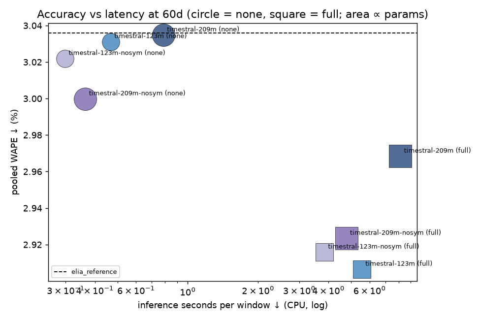

# symmetric_averaging_ablation

| data | SHA-256 |
|:--|:--|
| processed dataset `data/processed/elia_2024_2025.parquet` (input of every run) | `5863d97670fe6ec7ab1445125eef3941b8bf4b1aaaa4c2f25253645c33b6db81` |
| raw load `data/load.csv` (Elia ods001) | `e57db353662d0406ff5f75deccbb602b2bf104869e905cc0df0e5083a6f39188` |
| raw weather `data/weather_cov.csv` (Open-Meteo) | `73f6a63335b20eabcaef141c2fceaf83c860cf51e58571a69ba35709a27d7bfe` |

Windows per run: 365 (every day of 2025)  |  CPU threads: [8]  |  bootstrap: 2000 resamples of days, seed 42

Caveat: Open-Meteo has no issue timestamps; availability of the temperature covariate at 18:00 the day before cannot be proven.

## Conclusion

symmetric_averaging off: ~2x faster on CPU, no measurable accuracy loss (209M: small, probable gain; 123M: no effect).

## Acceptance gates

- **elia_reference pooled WAPE on 2025**: 3.0358% (target 3.036% ± 0.001) → **PASS**
- **Complete windows**: every aggregated run has 365/365 windows (aggregation refuses otherwise)

Leakage dates: 2025-03-15 (normal), 2025-03-30 and 2025-10-26 (DST), 2025-05-01 and 2025-12-25 (holidays). Determinism: 8 windows run twice, all stored quantiles compared. Re-run with `bench gates --config <experiment>`; stale = revision or adapter_version changed since recording.

| model                | leakage (noise after 17:45)   | leakage setting   | determinism (2 runs, bit-identical)   | determinism setting   | note   | recorded (UTC)   |
|:---------------------|:------------------------------|:------------------|:--------------------------------------|:----------------------|:-------|:-----------------|
| timestral-123m       | PASS                          | full, ctx 30      | PASS                                  | full, ctx 15          |        | 2026-10-20T09:58 |
| timestral-209m       | PASS                          | full, ctx 30      | PASS                                  | full, ctx 15          |        | 2026-10-20T09:59 |
| timestral-123m-nosym | PASS                          | full, ctx 30      | PASS                                  | full, ctx 15          |        | 2026-10-20T16:52 |
| timestral-209m-nosym | PASS                          | full, ctx 30      | PASS                                  | full, ctx 15          |        | 2026-10-20T15:47 |
| elia_reference       | PASS                          | default, ctx -    | PASS                                  | default, ctx -        |        | 2026-10-20T09:59 |

## Leaderboard
MW for MAE, RMSE, width, pinball, CRPS≈. Point metrics use P50, pooled over all scored points. eff. ctx = context actually fed to the model (baselines: days their definition needs). CRPS≈ = 2 × mean pinball over the common quantile set 0.1..0.9 (only where all 9 levels exist; the Elia reference has only 0.1/0.5/0.9, so compare it via the P10/50/90 pinball column).

| model                | covariates   | ctx (days)   |   eff. ctx (days) |   WAPE (pooled) ↓ % |   CI95 lo % |   CI95 hi % |   median-window WAPE ↓ % |   MAE ↓ |   RMSE ↓ |   sMAPE ↓ % |   P10-P90 coverage % (target 80) |   width ↓ |   pinball mean(0.1..0.9) ↓ |   pinball P10/50/90 ↓ |   CRPS≈ ↓ |
|:---------------------|:-------------|:-------------|------------------:|--------------------:|------------:|------------:|-------------------------:|--------:|---------:|------------:|---------------------------------:|----------:|---------------------------:|----------------------:|----------:|
| timestral-123m       | full         | 60           |                60 |                2.91 |        2.69 |        3.12 |                     2.31 |  266.08 |   374.92 |        2.91 |                            81.02 |    858.61 |                     105.07 |                 86.45 |    210.14 |
| timestral-123m-nosym | full         | 60           |                60 |                2.92 |        2.69 |        3.14 |                     2.22 |  266.94 |   381.97 |        2.92 |                            80.77 |    855.19 |                     105.7  |                 87.07 |    211.4  |
| timestral-209m-nosym | full         | 60           |                60 |                2.92 |        2.7  |        3.16 |                     2.31 |  267.63 |   384.73 |        2.92 |                            80.32 |    874.51 |                     106.57 |                 87.76 |    213.13 |
| timestral-209m       | full         | 60           |                60 |                2.97 |        2.75 |        3.19 |                     2.35 |  271.74 |   384.93 |        2.97 |                            82.21 |    932.9  |                     107.89 |                 88.91 |    215.78 |
| timestral-209m-nosym | none         | 60           |                60 |                3    |        2.76 |        3.25 |                     2.31 |  274.62 |   396.83 |        2.99 |                            79.46 |    844.3  |                     109.3  |                 90.05 |    218.6  |
| timestral-123m-nosym | none         | 60           |                60 |                3.02 |        2.79 |        3.26 |                     2.29 |  276.65 |   396.74 |        3.01 |                            78.44 |    833.59 |                     110.21 |                 90.95 |    220.42 |
| timestral-123m       | none         | 60           |                60 |                3.03 |        2.8  |        3.27 |                     2.31 |  277.49 |   395.85 |        3.02 |                            79.08 |    840.23 |                     110.45 |                 91.28 |    220.89 |
| timestral-209m       | none         | 60           |                60 |                3.03 |        2.8  |        3.28 |                     2.31 |  277.83 |   398.84 |        3.03 |                            79.82 |    858.74 |                     110.45 |                 91.07 |    220.89 |
| elia_reference       | -            | -            |                 0 |                3.04 |        2.85 |        3.23 |                     2.55 |  277.92 |   371.48 |        3.01 |                            75.47 |    831.71 |                      90.27 |                 90.27 |    nan    |

## Size curve (Timestral sizes at 60d context, chronos-2 as reference)
CPU latency on this machine (threads in the header). Mistral claims Timestral-28M beats Chronos-2: compare the Δ column at matching covariates. Δ < 0 = better than the reference.

| model                |   params (M) | covariates   |   WAPE ↓ % | Δ WAPE vs chronos-2 (pp)   |   CRPS≈ ↓ MW |   per window ↓ s |   total inference ↓ s |
|:---------------------|-------------:|:-------------|-----------:|:---------------------------|-------------:|-----------------:|----------------------:|
| timestral-123m       |          123 | full         |       2.91 | -                          |        210.1 |              6   |                  2029 |
| timestral-123m-nosym |          123 | full         |       2.92 | -                          |        211.4 |              4   |                  1404 |
| timestral-209m       |          209 | full         |       2.97 | -                          |        215.8 |              8   |                  2967 |
| timestral-209m-nosym |          209 | full         |       2.92 | -                          |        213.1 |              5   |                  1743 |
| timestral-123m       |          123 | none         |       3.03 | -                          |        220.9 |              0.5 |                   171 |
| timestral-123m-nosym |          123 | none         |       3.02 | -                          |        220.4 |              0.3 |                   109 |
| timestral-209m       |          209 | none         |       3.03 | -                          |        220.9 |              0.8 |                   287 |
| timestral-209m-nosym |          209 | none         |       3    | -                          |        218.6 |              0.4 |                   133 |

## Context sweep (pooled WAPE ↓ %, by configured context)
Where effective context differs from configured (e.g. a model maximum), the leaderboard's eff. ctx column shows it.

| model                | covariates   |   60d |
|:---------------------|:-------------|------:|
| timestral-123m       | full         |  2.91 |
| timestral-123m       | none         |  3.03 |
| timestral-123m-nosym | full         |  2.92 |
| timestral-123m-nosym | none         |  3.02 |
| timestral-209m       | full         |  2.97 |
| timestral-209m       | none         |  3.03 |
| timestral-209m-nosym | full         |  2.92 |
| timestral-209m-nosym | none         |  3    |

## Covariate effect (WAPE ↓ %; negative last column = covariates help)

| model                |   ctx (days) |   full |   none |   full − none (pp) |
|:---------------------|-------------:|-------:|-------:|-------------------:|
| timestral-123m       |           60 |   2.91 |   3.03 |              -0.12 |
| timestral-123m-nosym |           60 |   2.92 |   3.02 |              -0.11 |
| timestral-209m       |           60 |   2.97 |   3.03 |              -0.07 |
| timestral-209m-nosym |           60 |   2.92 |   3    |              -0.08 |

## Slices (pooled WAPE ↓ %)
weekday = Mon–Fri non-holiday; weekend = Sat/Sun; holiday_weekday = public holiday on Mon–Fri; non_holiday = all non-holiday days.

| model                | covariates   | ctx (days)   |   holiday_weekday |   non_holiday |   weekday |   weekend |   month_01 |   month_02 |   month_03 |   month_04 |   month_05 |   month_06 |   month_07 |   month_08 |   month_09 |   month_10 |   month_11 |   month_12 |
|:---------------------|:-------------|:-------------|------------------:|--------------:|----------:|----------:|-----------:|-----------:|-----------:|-----------:|-----------:|-----------:|-----------:|-----------:|-----------:|-----------:|-----------:|-----------:|
| elia_reference       | -            | -            |              3.42 |          3.02 |      3.12 |      2.78 |       2.69 |       2.54 |       3.85 |       3.6  |       2.35 |       2.47 |       2.79 |       2.29 |       2.48 |       2.82 |       4.43 |       3.96 |
| timestral-123m       | full         | 60           |              8.7  |          2.78 |      2.79 |      2.75 |       2.32 |       2.27 |       3.11 |       3.32 |       2.64 |       2.6  |       2.52 |       2.61 |       2.46 |       2.8  |       5.15 |       3.08 |
| timestral-123m       | none         | 60           |             11.71 |          2.84 |      2.91 |      2.64 |       2.83 |       2.56 |       3.19 |       3.38 |       2.92 |       2.69 |       2.89 |       2.78 |       2.36 |       2.74 |       4.9  |       3.1  |
| timestral-123m-nosym | full         | 60           |              9.58 |          2.77 |      2.81 |      2.67 |       2.43 |       2.23 |       3.07 |       3.33 |       2.57 |       2.65 |       2.71 |       2.52 |       2.45 |       2.78 |       5.15 |       3.09 |
| timestral-123m-nosym | none         | 60           |             11.78 |          2.83 |      2.89 |      2.65 |       2.78 |       2.59 |       3.27 |       3.4  |       2.78 |       2.69 |       2.92 |       2.71 |       2.36 |       2.73 |       4.88 |       3.12 |
| timestral-209m       | full         | 60           |              9.24 |          2.83 |      2.88 |      2.7  |       2.55 |       2.25 |       3.29 |       3.26 |       3.19 |       2.63 |       2.53 |       2.62 |       2.36 |       2.69 |       5.13 |       3.1  |
| timestral-209m       | none         | 60           |             12.3  |          2.83 |      2.9  |      2.65 |       2.93 |       2.51 |       3.19 |       3.37 |       2.99 |       2.62 |       2.85 |       2.85 |       2.34 |       2.69 |       4.91 |       3.11 |
| timestral-209m-nosym | full         | 60           |              9.25 |          2.78 |      2.83 |      2.66 |       2.47 |       2.34 |       3.4  |       3.08 |       3.02 |       2.33 |       2.53 |       2.48 |       2.27 |       2.72 |       5.16 |       3.21 |
| timestral-209m-nosym | none         | 60           |             12.42 |          2.79 |      2.85 |      2.63 |       2.83 |       2.49 |       3.17 |       3.32 |       2.9  |       2.56 |       2.85 |       2.71 |       2.37 |       2.71 |       4.86 |       3.17 |

## Paired comparisons (negative ΔWAPE = row is better; bootstrap over days; sign test over days)
Versus elia_reference for every run; versus chronos-2 at the same covariates/context where that run exists, else its best run (chronos-2 not in this experiment).

| model                | covariates   |   ctx (days) | vs             |   ΔWAPE ↓ (pp) | CI95          | days better   |   sign-test p |
|:---------------------|:-------------|-------------:|:---------------|---------------:|:--------------|:--------------|--------------:|
| timestral-123m       | none         |           60 | elia_reference |          -0    | [-0.23, 0.23] | 212/365       |      0.00235  |
| timestral-123m       | full         |           60 | elia_reference |          -0.13 | [-0.32, 0.07] | 212/365       |      0.00235  |
| timestral-209m       | none         |           60 | elia_reference |          -0    | [-0.24, 0.23] | 215/365       |      0.000786 |
| timestral-209m       | full         |           60 | elia_reference |          -0.07 | [-0.28, 0.14] | 214/365       |      0.00114  |
| timestral-123m-nosym | none         |           60 | elia_reference |          -0.01 | [-0.24, 0.22] | 211/365       |      0.00332  |
| timestral-123m-nosym | full         |           60 | elia_reference |          -0.12 | [-0.33, 0.10] | 217/365       |      0.000359 |
| timestral-209m-nosym | none         |           60 | elia_reference |          -0.04 | [-0.27, 0.20] | 214/365       |      0.00114  |
| timestral-209m-nosym | full         |           60 | elia_reference |          -0.11 | [-0.33, 0.10] | 215/365       |      0.000786 |

## Ablation pairs (variant vs its base model; same checkpoint, covariates and context)
Negative Δ = variant better. ΔWAPE and ΔCRPS≈ are pooled over all scored points; CIs bootstrap the 365 days (2000 resamples, seed 42); sign tests count days where the variant's per-window value is lower.

| variant              | vs base        | covariates   |   ctx (days) | WAPE variant / base %   | ΔWAPE ↓ (pp) [CI95]     | WAPE days better (sign p)   | ΔCRPS≈ ↓ (MW) [CI95]   | CRPS days better (sign p)   | inference time variant / base           |
|:---------------------|:---------------|:-------------|-------------:|:------------------------|:------------------------|:----------------------------|:-----------------------|:----------------------------|:----------------------------------------|
| timestral-123m-nosym | timestral-123m | none         |           60 | 3.02 / 3.03             | -0.009 [-0.037, +0.019] | 188/365 (0.601)             | -0.47 [-2.49, +1.48]   | 200/365 (0.075)             | 0.50x (controlled re-time (16 windows)) |
| timestral-123m-nosym | timestral-123m | full         |           60 | 2.92 / 2.91             | +0.009 [-0.037, +0.054] | 192/365 (0.346)             | +1.25 [-1.93, +4.39]   | 193/365 (0.295)             | 0.51x (controlled re-time (16 windows)) |
| timestral-209m-nosym | timestral-209m | none         |           60 | 3.00 / 3.03             | -0.035 [-0.067, -0.003] | 199/365 (0.0938)            | -2.29 [-4.36, -0.18]   | 204/365 (0.0278)            | 0.46x (full runs)                       |
| timestral-209m-nosym | timestral-209m | full         |           60 | 2.92 / 2.97             | -0.045 [-0.097, +0.007] | 194/365 (0.249)             | -2.65 [-6.04, +0.90]   | 212/365 (0.00235)           | 0.59x (full runs)                       |

## Latency

| model                | covariates   | ctx (days)   | device   |   threads |   batch |   load ↓ s |   total inference ↓ s |   per window ↓ s |
|:---------------------|:-------------|:-------------|:---------|----------:|--------:|-----------:|----------------------:|-----------------:|
| timestral-123m       | none         | 60           | cpu      |         8 |      16 |          1 |                   171 |              0.5 |
| timestral-123m       | full         | 60           | cpu      |         8 |      16 |          1 |                  2029 |              6   |
| timestral-209m       | none         | 60           | cpu      |         8 |      16 |          2 |                   287 |              0.8 |
| timestral-209m       | full         | 60           | cpu      |         8 |      16 |          2 |                  2967 |              8   |
| timestral-123m-nosym | none         | 60           | cpu      |         8 |      16 |          2 |                   109 |              0.3 |
| timestral-123m-nosym | full         | 60           | cpu      |         8 |      16 |          2 |                  1404 |              4   |
| timestral-209m-nosym | none         | 60           | cpu      |         8 |      16 |          2 |                   133 |              0.4 |
| timestral-209m-nosym | full         | 60           | cpu      |         8 |      16 |          2 |                  1743 |              5   |
| elia_reference       | -            | -            | cpu      |         8 |      64 |          0 |                     0 |              0   |

# Analyses

## Mirrored-pass test (timestral-209m, none, 60d, 365 windows)

direct = the pass `symmetric_averaging=False` returns; mirrored = forecast of −context, negated back and quantile-flipped; average = what `symmetric_averaging=True` returns.

| pass     |   WAPE ↓ % |   CRPS≈ ↓ MW |   P10-P90 coverage % |   width ↓ MW |
|:---------|-----------:|-------------:|---------------------:|-------------:|
| direct   |      3     |       218.6  |                 79.5 |          844 |
| mirrored |      3.114 |       226.5  |                 79.3 |          873 |
| average  |      3.035 |       220.89 |                 79.8 |          859 |

- Mirrored vs direct, paired over days: ΔWAPE +0.114 pp [+0.049, +0.176], mirrored better on 145/365 days (sign p 0.000102); ΔCRPS≈ +7.90 MW [+3.56, +12.12].
- Correlation of per-point P50 errors, direct vs mirrored: **0.9755** (mean |P50 direct − P50 mirrored| = 62.6 MW; direct RMSE 397 MW).
- Reproduction checks (max |ΔP50| vs the stored runs, MW): direct_vs_timestral-209m-nosym_max_abs_diff_P50_mw = 0, average_vs_timestral-209m_max_abs_diff_P50_mw = 0
